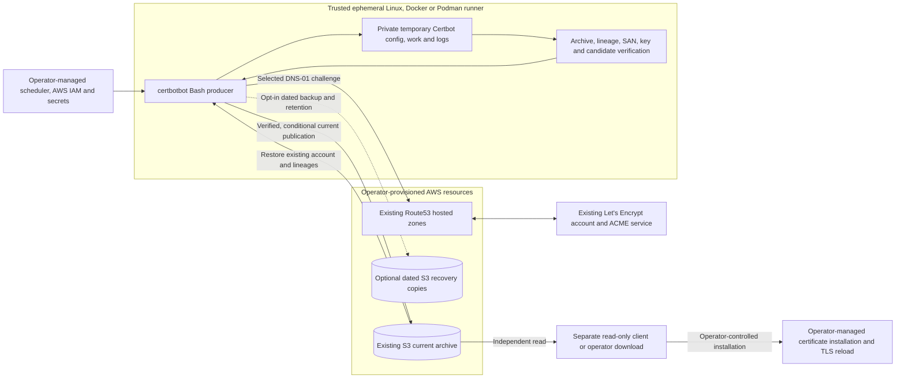

# certbotbot

**certbotbot** is a noninteractive certificate-management producer for
existing Let's Encrypt/Certbot accounts. It uses **Route53 DNS-01** to
issue or renew a selected certificate, persists the complete validated
Certbot account and certificate state in an **existing Amazon S3 object**,
and can resume on a fresh Linux runner without relying on that runner's
previous `/etc/letsencrypt` directory.

It is designed for scheduled or manually initiated, **one-shot Bash**
execution. Docker and rootless Podman are optional ways to run the same
producer; neither is required.

**[Releases](https://github.com/wesley-dean/certbotbot/releases) ·
[Complete lifecycle](doc/how-it-works.md) ·
[Configuration and CLI](doc/configuration-reference.md) ·
[Operator examples](#operator-examples) ·
[Architectural decisions](doc/decisions.md) ·
[Issues](https://github.com/wesley-dean/certbotbot/issues)**

## Why use certbotbot?

- **Ephemeral runners:** A new trusted machine can restore the existing
  registered account and certificate lineages from one configured S3 object.
  Only the S3 archive, not the runner's local workspace, is durable.
- **Explicit, bounded certificate selection:** One invocation targets **one
  named certificate lineage** with a validated set of DNS Subject Alternative
  Names (SANs), including unrelated domains. The same archive may preserve
  multiple independent lineages, but other lineages are not implicitly
  renewed or removed.
- **Verification before publication:** Downloaded archives, restored account
  state, selected certificate material, canonical renewal metadata, and
  candidate output pass separate checks. A verified unchanged no-op does
  **not** rewrite S3 by default.
- **Optional confidentiality and recovery copies:** Authenticated
  GnuPG AES-256/OCB encryption, a deliberately authorized
  plaintext-to-encrypted migration, dated recovery copies, and
  narrowly scoped backup retention are available as opt-ins. Backup
  publication defaults **off**; retention defaults to **zero deletes**.
- **Separation of concerns:** The producer owns certificate maintenance.
  A separately shipped **read-only client** can retrieve and validate the
  current archive; the operator owns installation and service reloads.
  A certificate-serving host does **not** need Certbot merely to consume
  validated certificate files.

### Supported boundaries

The current producer supports **S3 storage**, **gzip-compressed GNU tar**
state archives (optionally inside an authenticated GPG envelope), and
**Certbot with Route53 DNS-01**. It relies on a **previously registered
Let's Encrypt production account** and an **already seeded S3 archive**.

The tool does **not** create Let's Encrypt accounts, S3 buckets, IAM roles,
hosted zones, or the initial archive; provision a web server; install or
reload certificates on target hosts; automatically renew all stored
lineages; delete orphaned lineages; provide distributed locking; or
implicitly migrate encrypted/plaintext formats. Other storage backends,
DNS providers and archive formats are not supported by the current
producer. A container image is a distribution choice, not additional
account-provisioning or certificate-serving functionality.

See [How certbotbot works](doc/how-it-works.md) for the complete lifecycle
and [the threat model](doc/mvp-certificate-state-threat-model.md) for
specific trust boundaries and failure assumptions.

## How the pieces fit



An archive is the **contents of the Certbot configuration root**
(`/etc/letsencrypt`) using validated relative members and canonical
renewal metadata. The exact configured **current S3 bucket/key**
(default `latest.tar.gz`) is authoritative. A successful certificate
run does not imply downstream deployment. A failed or interrupted
S3 PutObject may have changed the remote object even if the
producer returns nonzero: the operation is **not** a transaction.

## Quick start: existing account and seeded archive

This is a **production-adjacent example, not an unattended setup
script or evidence of a live service test**. Prepare the prerequisites
before executing any credentialed command:

1. **Account and archive:** Register a suitable production
   Let's Encrypt account **outside certbotbot**. Populate an existing
   S3 bucket and current object with a valid full Certbot-state
   `tar.gz` containing that account, including its registration
   metadata and private key. An account-only archive is allowed
   for the initial certificate issuance; a missing archive or
   missing account is **not**.
2. **DNS and AWS identity:** Provision a Route53 hosted zone for
   the requested DNS-01 challenges and a trusted AWS CLI identity
   with narrowly scoped S3 reads/writes and necessary Route53
   TXT-change and status-check permissions. Configure AWS region,
   network access and credential delivery separately. If dated
   backups or retention are enabled, review their additional
   conditional-write/list/delete permissions first.
3. **Trusted Linux toolchain:** Install Bash **4.3+**, AWS CLI
   **v2**, Certbot with the `dns-route53` plugin,
   OpenSSL, GNU tar/gzip and standard file/hash utilities.
   GnuPG **2.4.7+ with working AES-256/OCB support** is
   additionally required for encrypted archives. The runner
   must keep its temporary Certbot workspace private.
4. **Reviewed release artifact:** Choose an immutable reviewed
   release tag, verify the [release checks and provenance](doc/release-verification.md),
   and obtain an **independently verified** SHA-256 for the
   ordinary `certbotbot.bash` executable. Never treat the
   downloaded executable and its same-origin checksum alone as
   sufficient proof of release trust.
5. **Only one writer per current key:** Schedule and coordinate
   certificate jobs so that two producers cannot concurrently
   modify the same authoritative bucket/key, even across
   Jenkins, GitHub Actions, containers and other hosts.

With the GitHub CLI, a trusted `sha256sum` implementation and
the expected digest obtained **out-of-band from your review**,
the following shell example fails closed until its placeholders
are replaced:

```bash
set -euo pipefail
umask 077

RELEASE_TAG='vREPLACE_WITH_REVIEWED_TAG'
EXPECTED_SHA256='REPLACE_WITH_INDEPENDENTLY_REVIEWED_64_HEX_DIGEST'

[[ "$RELEASE_TAG" =~ ^v[0-9]+\.[0-9]+\.[0-9]+$ ]]
[[ "$EXPECTED_SHA256" =~ ^[0-9a-f]{64}$ ]]

mkdir -m 0700 ./certbotbot-release
cd ./certbotbot-release
gh release download "$RELEASE_TAG" \
  --repo wesley-dean/certbotbot \
  --pattern certbotbot.bash \
  --pattern certbotbot.bash.sha256

sha256sum --check certbotbot.bash.sha256
actual="$(sha256sum certbotbot.bash | awk '{print $1}')"
[[ "$actual" == "$EXPECTED_SHA256" ]]
gh attestation verify certbotbot.bash \
  --repo wesley-dean/certbotbot >/dev/null
gh attestation verify certbotbot.bash.sha256 \
  --repo wesley-dean/certbotbot >/dev/null

bash -n certbotbot.bash
chmod 0700 certbotbot.bash
./certbotbot.bash --help
./certbotbot.bash --version
```

For the **standalone Bash tools**, rather than the container image,
the ordinary producer and separate read-only client are available from
[GitHub Releases](https://github.com/wesley-dean/certbotbot/releases).
You can also use [`vet`](https://github.com/vet-run/vet) to download,
inspect, lint (when ShellCheck is available), and explicitly approve
a remote release script **before executing it**, for example:

~~~bash
vet https://github.com/wesley-dean/certbotbot/releases/latest/download/certbotbot.bash --help
vet https://github.com/wesley-dean/certbotbot/releases/latest/download/certbotbot-client.bash --help
~~~

`vet` runs the fetched script for this invocation; it does not install
a permanent copy or replace independent release and attestation checks.
Use the release assets above when you need locally installed executables.

The download commands intentionally do **not** contact S3, Route53
or ACME. Once the real account, archive, permissions and selected
domain have been **independently prepared**, an ordinary invocation
from that private directory looks like:

```bash
./certbotbot.bash \
  --s3-bucket my-existing-certificates \
  --s3-key latest.tar.gz \
  example.com
```

Here `my-existing-certificates` and `example.com` are **illustrative
values**, not provisioned resources. The default
`INCLUDE_SUBDOMAINS=true` also requests the complementary wildcard
SAN, so `example.com` normally requests both `example.com`
and `*.example.com`. Use `--include-subdomains false`
when only the literal name is desired. For a stable lineage
across SAN changes, use an explicit `--cert-name`.

A successful run prints a nonsecret selected-lineage and
`s3://bucket/key` status containing `published=true`
or `published=false`. An unchanged, validated no-op is still
success and normally skips the remote write. A failed provider,
unsafe archive, mismatched certificate/key or incomplete candidate
must not authorize publication; after an attempted remote write,
the remote state can be **uncertain**. Inspect the current object
independently rather than blindly retrying a failed or partial
publication. See [failure and recovery details](doc/how-it-works.md).

## Common configuration

Settings resolve **CLI > explicitly exported environment >
literal selected `.env` > built-in defaults**. Without an
explicit `--config FILE`, the optional `./.env` file is read
as strict **data**, never sourced as shell code. Unknown or
duplicate entries and shell expansion are rejected. The
[full configuration reference](doc/configuration-reference.md)
is authoritative for values, edge cases, precedence and all
public flags.

| CLI | Environment / literal `.env` | Default or purpose |
| --- | --- | --- |
| `DNS_NAME` or `--domain` | `DOMAIN` | **Required** primary DNS name |
| `--san` (repeatable) | `ADDITIONAL_SANS` | Optional additional names; CLI replaces lower-tier SAN collection |
| `--include-subdomains` | `INCLUDE_SUBDOMAINS` | `true`; add complementary apex/wildcard for each name |
| `--cert-name` | `CERT_NAME` | Derive shortest valid SAN name unless explicitly set |
| `--s3-bucket` | `S3_BUCKET` | **Required** existing bucket |
| `--s3-key` or `--s3-key-template` | `S3_KEY` or `S3_KEY_TEMPLATE` | Current object; default literal `latest.tar.gz` |
| `--upload-no-renewal` | `UPLOAD_NO_RENEWAL` | `false`; do not republish an unchanged verified no-op |
| `--dated-backup-enabled` | `DATED_BACKUP_ENABLED` | `false`; opt in to an additional dated recovery object |
| `--backup-key-template` | `BACKUP_KEY_TEMPLATE` | `archive-{YEAR}{MONTH}{DOM}.tar.gz`; naming alone does not enable publishing |
| `--backup-retention-count` | `BACKUP_RETENTION_COUNT` | `0`; **no deletion** unless positive and dated backups enabled |
| `--archive-encryption` | `ARCHIVE_ENCRYPTION` | `auto`: plaintext without key, GPG OCB with exported key |
| `--archive-migration` | `ARCHIVE_MIGRATION` | `none`; explicit one-way migration only |
| `--archive-migration-backup-confirmed` | `ARCHIVE_MIGRATION_BACKUP_CONFIRMED` | `false`; independent recoverable-backup acknowledgment |

The **secret** `GPG_SYMMETRIC_KEY` is accepted **only as an
exported process-environment variable**, never as a CLI option
or literal `.env` key. Use a trusted secret manager and ensure
it is absent from command arguments, build inputs, files and
logs. Selecting `ARCHIVE_ENCRYPTION=none` while supplying a
nonempty key fails closed; migration requires explicit mode,
key and independently confirmed backup.

The current key and a separately selected date-derived
current-key template conflict **only when both are set at the
winning precedence tier**. Templates use a frozen UTC date
and the supported `{YEAR}`, `{MONTH}`, `{DOM}` tokens.
Positive retention additionally requires stricter managed
date-shaped backup keys and can delete eligible older
objects. No option automatically creates a recovery backup
or restores it on failure.

Run `./certbotbot.bash --help` or
`./certbotbot.bash --version` without cloud access.
The full reference covers exact Boolean syntax, SAN limits,
status codes, invalid combinations and encryption migration
safety.

## Standalone read-only client

The separate `certbotbot-client.bash` release artifact retrieves
**one current** selected S3 object, validates it, and extracts
the complete supported Certbot state into a **new, absent
operator-selected destination**. It does not issue or renew
certificates, write to S3, delete backups, install certificate
files into a service or reload that service. A target system
does not need Certbot to use previously issued material.

Download its matching `.sha256` companion, independently
verify the release and attestations as above, then invoke
the client with an existing read-only AWS identity and
a fresh private destination:

```bash
./certbotbot-client.bash \
  --s3-bucket my-existing-certificates \
  --s3-key latest.tar.gz \
  --destination "$HOME/certificate-states/current"
```

The destination **must not already exist**, and its parent
must satisfy the client's private-directory requirements.
For encrypted objects, the client also needs compatible GnuPG
and a matching exported secret. See
[client settings](doc/client-settings.md),
[client examples](doc/examples/certbotbot-client.md) and
[the separate-client contract](doc/separate-client-contract.md)
before adoption. The client is shipped **separately** and
is not embedded in the producer's OCI image.

## Containers and operator examples

The optional [Alpine OCI producer](Dockerfile) executes the
same one-shot CLI in Docker or rootless Podman. Its reviewed
scope is **linux/amd64**, nonroot UID/GID **65532**, a private
ephemeral state directory, a read-only root filesystem and
no baked credentials or ACME material. The image does **not**
schedule itself or automatically deploy certificates. AWS
workload identity or securely injected runtime credentials
must be provided by the operator.

After a successfully verified release, the publisher targets GHCR and
Docker Hub. To pull and inspect the current image from either registry:

~~~bash
docker pull --platform linux/amd64 ghcr.io/wesley-dean/certbotbot:latest
docker image inspect ghcr.io/wesley-dean/certbotbot:latest \
  --format '{{.Os}}/{{.Architecture}} {{.Config.User}}'

podman pull --arch amd64 --os linux docker.io/wesleydean/certbotbot:latest
podman image inspect docker.io/wesleydean/certbotbot:latest \
  --format '{{.Os}}/{{.Architecture}} {{.Config.User}}'
~~~

`latest` follows the most recently accepted release and can change.
For reproducible deployments, pinning a particular release or an
independently verified image digest is encouraged. See the deployment
guide for those options and for secure runtime examples. These commands
do not establish that a release image has already been published or
accepted in either registry.

The [Docker/rootless Podman published-image quick start](doc/examples/docker-podman.md#use-an-independently-verified-published-image)
includes direct `docker`/`podman` pull, label inspection, nonroot
read-only run examples, and the additional prerequisites for real
issuance. See the [full container deployment guide](doc/container-deployment.md),
[OCI publication and operator guide](doc/oci-image-publication.md), and
[publication contract](doc/oci-publication-contract.md) for
trust, credentials, registry recovery, upgrades, and release boundaries.
Local image build/runtime tests do **not** prove live registry
publication or certificate issuance in your environment.

### Operator examples

Examples under `doc/examples/` are **references, not active
production automation**:

- [Jenkins Pipeline and adoption guide](doc/examples/jenkins.md)
  with an [example-only Jenkinsfile](doc/examples/Jenkinsfile)
- [GitHub Actions workflow and OIDC guide](doc/examples/github-actions.md)
  with an [inert workflow example](doc/examples/certbotbot.yml)
- [Docker and rootless Podman runtime](doc/examples/docker-podman.md)
- [Standalone certificate client](doc/examples/certbotbot-client.md)

In particular, the GitHub Actions example is deliberately
**outside `.github/workflows/`**. An operator must separately
review and activate a protected workflow, credentials, IAM
trust policy, release pin and schedule. Examples do not
provision accounts or buckets, run live cloud operations on
PRs, or deploy certificates to consumer servers.

## Building, testing and contributing

The maintained Bash source lives in `src/` and `lib/`.
GNU Make is the canonical build and test entrypoint.
Bash dependencies (including the pinned `mktext`
library used for safe filename templates) are prepared
before building; the resulting standalone scripts have
no runtime dependency on the repository's `vendor/` tree.

```bash
make deps
make deps-check
make build
make check
make test
```

`make deps` can access the network; `make deps-check`
and `make build` are network-free once dependencies
are prepared. `make test-report` writes JUnit output.
`make format` applies the repository's shfmt profile,
`make adr-index` generates temporary ADR navigation,
and `make docs` generates Doxygen reference output
without committing generated files.

The eight release assets comprise the three producer
flavors (`certbotbot.dev.bash`, `certbotbot.bash`,
`certbotbot.min.bash`) plus the distinct
`certbotbot-client.bash`, each with its `.sha256`
companion. Release CI independently verifies the
producer variants, required Bash compatibility and
authenticated standalone client, then attests the
exact files before releasing them. Read
[release verification](doc/release-verification.md)
before pinning executable versions or adopting a
production runner.

For contributor onboarding, start with
[AGENTS.md](AGENTS.md),
[testing guidance](doc/testing.md),
[the engineering philosophy](doc/engineering-philosophy.md),
[the architecture decision map](doc/decisions.md),
[accepted ADRs](doc/adr/README.intro.md),
[the Bash documentation standard](doc/documentation-standard.md),
[CONTRIBUTING.md](CONTRIBUTING.md),
and [the security disclosure policy](SECURITY.md).
The generated ADR index and Doxygen reference output
are not maintained source.

This repository uses an opt-in,
[three-phase approved development workflow](doc/standards/general/three-phase-development-governance.md).
A current issue's `approved` label records its own
authorization, not blanket permission for related
tasks; substantive architecture changes must respect
Accepted ADRs. Issues and PRs are reviewed separately
from CI success.

For support and project status, use
[SUPPORT.md](SUPPORT.md),
[GitHub Issues](https://github.com/wesley-dean/certbotbot/issues),
and [GitHub Actions](https://github.com/wesley-dean/certbotbot/actions).
The historical research record is in
[doc/research/](doc/research/README.md).
The project adopts a pinned released snapshot of
[coding standards](https://github.com/wesley-dean/coding_standards)
through [`.codingstandardrc`](.codingstandardrc).

## License

Dedicated to the public domain under **CC0 1.0 Universal**.
See [LICENSE](LICENSE), [CONTRIBUTING.md](CONTRIBUTING.md),
and [CODE_OF_CONDUCT.md](CODE_OF_CONDUCT.md).
