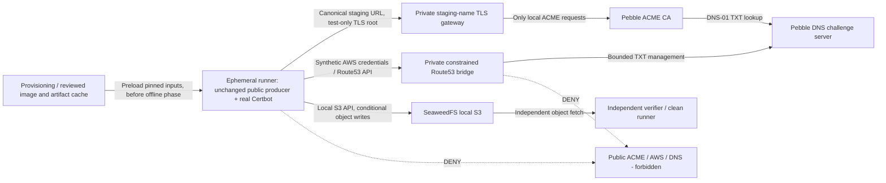

# ADR-046: Isolated Pebble and SeaweedFS Protocol-Level E2E Trust Boundary

Date: 2026-11-02

## Status

Accepted

**Implementation status:** This is the architecture decision for approved
milestone #16 task #240, proposed for review and merge. The decision is not
evidence that Pebble, SeaweedFS, container engines, or the complete lifecycle
have been exercised successfully. The implementation and acceptance gates remain
in tasks #241-#248. By repository convention, Accepted is the status of a
decision submitted for review and merge.

## Decision

Build a **container-confined, credential-free-from-real-providers, protocol-level
E2E harness** for the **actual assembled public certbotbot producer** and the
existing real Certbot and `dns-route53` plugin. Run prepublished, versioned,
immutable-digest-pinned Pebble and SeaweedFS OCI images, Pebble's challenge
test server, and only the minimum reviewed local gateway/adapter services
required to make the existing interfaces interoperable. Docker is the initial
verification target; rootless Podman support is an additional measured
compatibility result, never an assumption.

**The shipped producer gains no arbitrary CA URL selector, general-purpose
endpoint flag, permanent test CA trust root, test registration bypass, or
production-accessible force-renewal option.** Its accepted CA values remain
`production` and `staging` and its selected account, server, lineage,
and publication validation remain governed by ADRs 020-030, 041 and 042.
The local test harness must keep all test-only interception and trust outside
the public producer bytes. If an exact public artifact cannot perform the
required local protocol exchange without weakening those contracts, fail
the feasibility gate and request a specific reviewed refinement before
implementing a broader seam. Do not silently modify the public contract
to make a test pass.

### ACME authority and identity

Select **`--acme-environment staging` explicitly** inside the E2E harness
so no test may accidentally use the production compatibility default.
A disposable, unprivileged **test-only TLS gateway** on the sealed runner
network may present the exact staging directory hostname to the unchanged
producer and forward the actual RFC 8555 exchange to Pebble. The harness
may map the exact staging host to that gateway by private container DNS or a
private hosts mapping. The gateway's certificate must match the selected
hostname, and its issuing **test root** must be trusted only within the
disposable test runner. TLS verification stays enabled. The gateway must
allow only declared internal ACME hosts, ports, and protocol destinations;
absolute Pebble response URLs must be handled only through a reviewed,
bounded local mapping, never unrestricted proxying or internet redirects.

The endpoint *presented to the producer* therefore retains ADR-042's literal
staging selection and canonical account-directory path
`accounts/acme-staging-v02.api.letsencrypt.org/directory/<id>/`.
The **real issuing CA is Pebble, not Let's Encrypt staging**. Do not describe
this as staging-provider interoperability or export the resulting account
archive as a legitimate Let's Encrypt staging seed. Certbot must create its
native `private_key.json`, `regr.json`, and `meta.json` files from a real
ACME registration. No synthetic account JSON, fake certificate, forged
renewal state, or manipulation of archived authority is permitted.

This network-mediated approach is conditional on proving that real Certbot
accepts the complete redirect/link/TLS/account lifecycle while the current
certbotbot CA-bound state validator continues to pass. In particular, Pebble
may emit absolute internal order/account URLs: the harness must verify
those URLs cannot trigger external egress and do not break the native
Certbot account or canonical renewal contracts. If those assumptions fail,
task #241 must report the failure and bring a narrowly scoped alternative
back for architectural approval. A green mocked Certbot fixture does not
resolve that incompatibility.

### Storage and DNS authority

Use a **distinct private SeaweedFS S3-compatible service** with an existing
test bucket and one known disposable current key per test. Invoke the real
AWS CLI used by certbotbot. Route its S3 API calls to SeaweedFS through a
harness-controlled service endpoint such as `AWS_ENDPOINT_URL_S3`, subject
to measured support in the installed AWS CLI. The test requires real
HeadBucket, HeadObject, GetObject, PutObject, and applicable conditional
`If-None-Match` / `If-Match` behaviors. It must separately verify missing
object versus denial/service faults, conditional-write failures, independent
readback, and remote object identity. SeaweedFS compatibility, especially
conditional write semantics and returned ETag syntax, is a **test
prerequisite**, not a fact established by selecting the image. An adapter
must not fabricate evidence that SeaweedFS itself enforced a condition.

Run real Certbot with the existing `dns-route53` authenticator. A
**narrow, private Route53 API simulation** may translate the exact
Route53 operations needed by the plugin into Pebble challenge-server
`_acme-challenge` TXT creation, polling, and cleanup. Prefer the
installed botocore/CLI service-specific endpoint routing, such as
`AWS_ENDPOINT_URL_ROUTE53`, **only after verifying the actual plugin
honors it**. This is a harness-side provider compatibility mechanism,
not a newly supported user-configurable DNS backend. Permit only
an explicit synthetic hosted zone and expected challenge names, values,
operations, and call ordering. Reject all unrelated zone access,
unsupported API requests, and external Route53 endpoints. Signatures,
credentials, error codes, and polling responses must be realistic enough
to exercise the genuine plugin rather than substituting a successful
mock Certbot command. Pebble independently resolves the TXT value
through its challenge server. The challenge server's unauthenticated
management interface is never published to the host or public network.

All AWS credentials are syntactically plausible **nonfunctional local
fixtures**. Clear AWS profiles, shared credentials, web-identity,
credential-process/configuration inheritance, container/instance
metadata, and cloud-specific environment leftovers before runner
startup. Supply only the expected local fixture credentials, region
and explicit endpoints. Deny metadata, public AWS, and production
ACME/DNS network routes at the container boundary rather than relying
on redaction or test intent.

### Containers, dependencies, and no-egress runtime

Acquire upstream images and toolchain dependencies **before** the test
workload. Review the source registry, version, architecture, manifest
digest, transitive dependencies, licenses, published security status,
runtime user, exposed ports, and entrypoint. Record immutable
`image@sha256:...` identities in the eventual harness and CI, and
verify pulled image identities before use. Tag-only pins and mutable
`latest` are insufficient. Do not compile Pebble or SeaweedFS, build
their upstream server images locally, or install their server binaries
on the host. A reviewed, purpose-built bridge or gateway is distinct
from compiling an upstream server; its own source, provenance and
runtime authority also require review.

The test runners, gateway, Pebble, challenge test server, and SeaweedFS
must communicate only over **disposable internal container networks**.
No published management or service ports, host networking, privileged
containers, external DNS fallback, shared home directories, Docker
socket exposure to the runner, or mounts of host Certbot/AWS state are
allowed. Separate service-management access from runner access where
the engine permits. Container storage, keys, account files, logs,
lineages, work directories, and caches are ephemeral. Readiness
checks must be bounded and must establish actual protocol readiness,
not merely container-process liveness. Teardown must remove the
network, containers, and disposable volumes even on failed tests.

The test execution phase must work **offline after all images, build
artifacts, and dependencies are cached**. Verify that the actual
runner network has no outbound route, no working public DNS, and
no access to real Let's Encrypt, AWS S3, Route53, or metadata IPs.
The host or CI orchestrator may still have internet access to download
inputs before isolation; that privilege does not extend into the
runner. Network isolation is an enforced boundary to test and observe,
not a property inferred from a compose file alone. CI uses no real
GitHub AWS secrets or live ACME account keys.

### Exact public-artifact and lifecycle contract

The harness must execute the **built, checksum-verified public producer**
with its documented command line, not test a helper-only implementation.
The development, ordinary, and minified producer flavors remain a
parity requirement; the separate read-only client is a distinct
artifact with separate retrieval/restore assertions. Reuse the
existing ADR-036 build and artifact-identity discipline. Preserve
release and ordinary CI behavior.

Acceptance is one repeatable scenario with independent assertions:

1. Start healthy isolated services with a positively **absent** S3
   current object. Ordinary issuance must refuse missing state, while
   read/permission faults must not be misclassified as absence.
2. Invoke **explicit** `certbotbot register` with test contact and
   explicit consent, then independently fetch the new native
   account-only archive from SeaweedFS. Assert no certificate order
   and no accidental regular issuer bootstrap.
3. Invoke ordinary first issuance from that archive. Real Certbot
   and `dns-route53` must complete an ACME DNS-01 challenge against
   Pebble, and the producer must validate and publish the selected
   certificate-bearing state. Independently verify SANs, certificate,
   selected lineage, account continuity, and remote bytes.
4. Destroy the entire first disposable runner and all of its Certbot
   state. A distinct, empty runner must restore solely from the
   current SeaweedFS object, including account, selected certificate
   and key, renewal configuration, and object identity. No host
   fallback is permitted.
5. Run a normally not-yet-due selected renewal check. Prove **zero**
   new ACME orders and no rewritten S3 current object when
   `UPLOAD_NO_RENEWAL=false`.
6. In a separate isolated test phase, exercise a **second genuine**
   Pebble ACME order for a cert that is due or under an expressly
   authorized **test-only** renewal condition. Prefer an isolated
   controlled clock/short-lived test certificate if supported by
   actual Certbot and the unchanged producer. Do not presume a
   public force-renewal flag exists. Any alternative test-only
   trigger must be documented and architecturally reviewed before
   execution; it must not leak into normal production invocations.
7. Re-download the published renewed object independently. Assert
   changed DER certificate fingerprint, stable selected lineage and
   account identity, new current-object identity, preserved unrelated
   validated state, and no forbidden egress. Private-key rotation is
   **not** required unless the product contract is changed
   separately.

Passing the no-op path is **not** evidence of real renewal. Required
negative evidence covers ACME failure, DNS rejection/cleanup, missing
versus inaccessible S3 object, Get/Put faults, malformed archive,
account/CA mismatch, conditional conflict, candidate validation
failure, refusal of production/foreign endpoints, no success after
failed publication, and absence of private data in CI diagnostics.
A failed or interrupted PutObject may leave remote state uncertain;
the test must not promise rollback that S3 does not provide.

### CI and execution boundaries

A separate, unprivileged local E2E entry point and CI job may be
added under task #247. Its gate must include a genuine second order,
independent remote readback, negative assertions, runtime egress
evidence, container identity/provenance, bounded timeouts, and cleanup.
It must not inject production/staging provider credentials or depend
on access to live hosted zones, buckets, or public CAs. It must not
alter the manually dispatched live staging acceptance workflow
governed by ADR-043, nor re-enable the separately suspended
native issue dependency synchronizer under ADR-045.

## Context and Decision Drivers

Milestone #16 (story #236 and technical task #240) requires a
repeatable, local end-to-end demonstration of account registration,
real ACME/DNS-01 issuance, archive persistence, fresh-runner
restoration, non-due no-op, and genuine selected renewal. The existing
Bats public-artifact tests use process mocks; those are important
behavior evidence but do **not** prove protocol interoperability.
The manual milestone #4 workflow uses actual Let's Encrypt staging
and real AWS resources, and remains a distinct acceptance gate.

ADR-041 makes registration an explicit, consent-bearing operation.
ADR-042 binds ordinary production/staging issuance to two exact
Let's Encrypt identities and forbids arbitrary directory URLs.
ADRs 020-030 require a preseeded ordinary-issuance archive,
private native Certbot state, selected-lineage validation, and
conditional preservation/publication. ADR-015 treats even CI-only
dependencies as trusted attack surface; ADR-016 requires explicit
security objectives, threats, evidence and residual risk. The
local fixture must not weaken any of these contracts.

This decision prioritizes **fidelity of public producer bytes,
defense against real-provider contact, and clear evidence
boundaries** over ease of making a test pass.

## Trust-Boundary Diagram

The diagram is a logical authority-flow view. Physical routing, actual
container namespace sharing, DNS resolution, TLS peer identity,
botocore endpoint precedence and bridge API fidelity must be tested
before they are treated as implementation facts.

## Threat Model

**Assets:** native ACME registration and private keys; selected
certificate key and renewal metadata; current S3 object bytes;
synthetic DNS challenge values; CI artifacts, logs, and runner
identity; real cloud/CA account and network boundaries.

**Trusted computing base:** reviewed producer artifacts, real
Certbot and plugin, AWS CLI/botocore, container engine/network
isolation, test TLS gateway, Route53 bridge, pinned Pebble and
challenge server, pinned SeaweedFS, private verifier, and
CI orchestration. Pinning establishes intended bytes; it does not
make this code or the engine inherently safe.

| Threat or ordinary failure | Mitigation / required evidence | Residual risk |
| --- | --- | --- |
| Test accidentally reaches production CA | Explicit staging selector, private name mapping, deny external routes, negative production-connectivity probe | Host or compromised engine can violate isolation |
| Test CA is accepted by host/prod | Runner-only root bundle and disposable mount; assert no host CA change | Compromised runner can misuse its local trust |
| ACME absolute URL escapes proxy | Exact internal allowlist, TLS peer validation and network denial; inspect outbound destinations | Client/gateway incompatibilities may block the design |
| Real AWS credentials inherited | Clean environment and synthetic credentials; metadata/profiles denied; inspect process env exposure | Host/container-engine compromise is outside Bash isolation |
| Fake DNS success without real DNS-01 | Real Certbot plugin, bounded Route53 translation, Pebble DNS lookup and order evidence | It does not verify public Route53 behavior |
| Unauthorized zone or TXT mutation | One synthetic zone and challenge-name allowlist, cleanup and fault tests | Concurrent challenge behavior requires actual testing |
| SeaweedFS differs from S3 conditions | Exercise real conditional APIs and independent reads; refuse unsupported semantics | Not equivalent to all S3/IAM behavior |
| Unsafe archive or CA identity | Existing selected-state validators unchanged; foreign/malformed state negative cases | Fixtures cannot prove live CA recognizes an account |
| Stale runner state masks restore | Destroy first runner and use new namespace/volumes, no host Certbot mounts | CI host compromise may expose both runners |
| No-op falsely reported as renewal | Count orders, compare DER fingerprints, object identity, and fresh readback | Virtual time/test-only trigger may differ from production timing |
| Debug output leaks secrets | Bounded nonsecret evidence, no raw logs/artifacts, sentinel scanning | Logs in a compromised host are outside test control |
| Upstream image drift or compromise | Reviewed digest pins, architecture/version record, provenance and update review | Signed/pinned images may still contain vulnerabilities |
| Shutdown leaves live mutation | Internal-only network; fault-injection and teardown checks | A failed external S3 write cannot be rolled back by the test |
| Service startup hangs | Timed readiness checks, explicit failures, trap/cleanup and no retry loops hiding faults | Engine instability remains possible |

**Adversaries/failure sources:** compromised upstream image,
untrusted test archive, rogue runner environment, accidental operator
error, misconfigured container engine, inconsistent AWS SDK
endpoint behavior, uncertain S3 writes, malformed ACME/Route53
responses, and future maintenance that accidentally widens the
test seam. The threat model does not claim defense against an
already compromised host/engine administrator.

## Verification and Feasibility Gates

Task #241 must establish, on the **actual built producer**, that the
chosen staging-name mediation does not require a new public server
option or weaken account/renewal validation; test TLS remains
enabled and neither primary nor response-derived URLs can leave
the private network. Task #242 must verify image digests and
runtime isolation. Task #243 must prove the actual Certbot
`dns-route53` plugin talks solely to the test bridge and that
Pebble observes the correct TXT records. Task #244 must confirm
SeaweedFS conditional writes and account-only registration, then
real first ACME issuance. Tasks #245 and #248 must prove separate
restore/no-op and **real renewal**. Task #246 supplies negative
failure coverage; task #247 enforces the full contract in CI.

If a required facility is unavailable (for example, supported
Route53 endpoint routing, SeaweedFS conditional semantics, valid
Certbot account reuse after gateway mediation, or a safe genuine
second-order trigger), report the **specific failed prerequisite**
and do not downgrade to mocks, disable certificate validation,
reclassify a failed operation as success, alter public CA choices,
or claim milestone acceptance. Any required new production-facing
interface or behavior needs a separately approved ADR/task before
implementation. Routine implementation mechanics that preserve this
decision stay within the already approved tasks.

Evidence must identify the exact public artifact bytes, tested
provider versions and image digests, active container engine,
network-denial probes, scenario, assertions and failures. Mock-only,
protocol-level local, and live-provider observations are **three
different evidence categories** and must never be collapsed.

## Considered Alternatives

1. **Accept arbitrary `--server` / `ACME_DIRECTORY_URL` in the public
   producer:** rejected. It contradicts ADR-042 and exposes account
   identity, archive and trust boundaries to arbitrary endpoints.
2. **Add a hidden environment-variable test URL to all shipped
   flavors:** rejected. Hidden configuration is still a
   production-accessible authority bypass.
3. **Generate a specially patched producer artifact for tests:**
   rejected as primary proof. Its bytes differ from the shipped
   producer, potentially hiding release or validation regressions.
4. **Mock the `certbot` executable or synthesize issued PEMs:**
   retained for focused unit/contract suites, rejected as positive
   protocol-level E2E evidence.
5. **Use real Let's Encrypt production or staging and real AWS in
   ordinary PR CI:** rejected. It violates isolation and conflates
   milestone #16 with manually governed milestone #4.
6. **Install or build Pebble/SeaweedFS on the host:** rejected by
   the container-only upstream server policy and its repeatability
   and cleanup requirements.
7. **Use public DNS redirection without a sealed test network:**
   rejected. This could redirect real-client traffic, leak
   account state, or permit unexpected fallback to a live CA.
8. **Use an ACME proxy with disabled TLS checks:** rejected.
   Test-only trust must be explicit and confined; no
   insecure-verify path is allowed.
9. **Use only SeaweedFS mocks for S3 conditionals or only a DNS
   mock for challenges:** rejected as complete local E2E evidence.
   Target services and protocols must actually process the
   required requests.
10. **Claim success after a newly issued certificate's no-op:**
    rejected. Actual renewal requires a distinct real order and
    changed certificate bytes.
11. **Expose a general public force-renewal switch to simplify
    CI:** rejected without separate product governance. A test
    may use only a bounded, reviewed, container-local renewal
    condition that does not change public behavior.

## Consequences, Compatibility, and Migration

Existing CLI options, default production behavior, staging opt-in,
account archive format, three producer flavors, separate client,
conditional S3 semantics, local Bats mock suites, normal CI/release
pipeline, and manually authorized milestone #4 acceptance are
unchanged by this architecture decision. No migration of existing
S3 keys, accounts, or certificate lineages is permitted or needed.
Milestone #16 does not grant authority to change public provider
contracts or production credential delivery.

The chosen approach puts more complexity into the harness: internal
TLS/name mediation, local test trust, exact AWS client endpoint
routing, realistic Route53 API responses, deterministic Pebble DNS,
container isolation and compatibility probes. That complexity is
deliberate because testing a different binary or relaxing CA
validation would create misleading evidence. Docker feasibility
must be demonstrated before any Podman parity claim is made.

A completed local E2E establishes behavior against the **tested
versions of Pebble, SeaweedFS, bridge, real Certbot and test network**.
It does not establish Let's Encrypt staging/production, genuine
Route53 IAM/propagation, AWS S3 durability/consistency, container
security against a malicious host, or guaranteed successful renewal
in operational environments. Those limits remain visible in the
completion report.

## Related Decisions and Scope

- ADR-015: upstream images, adapter code and CI tools are dependency
  attack surface, even if absent from the public executable.
- ADR-016: explicit authority/data-flow threat model and residual risks.
- ADRs 020-030: seeded ordinary issuance, native portable state,
  selected certificate and verified conditional publication.
- ADR-035/036: separate client and verified public artifact evidence.
- ADR-038/039/040: OCI producer distribution and bounded image
  provenance; not blanket authority to substitute upstream servers.
- ADR-041: explicit account registration and conditional account-only
  archive initialization.
- ADR-042: immutable production/staging CA selection, explicit account
  identity and no arbitrary public endpoint.
- ADR-043: separate owner-dispatched, staging-only **live** acceptance.
- ADR-045: suspended native issue dependency synchronization remains
  a separate remediation concern.

This decision is scoped to milestone #16, story #236 and task #240.
The implementation tasks and their recorded blockers remain
independently approved work; **one task still means one cohesive PR**.
