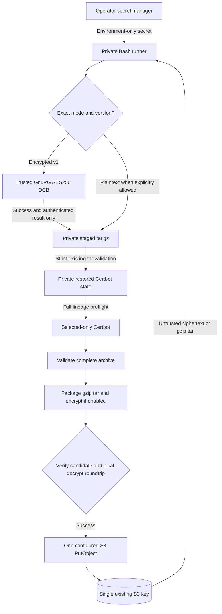

# Client-Side Archive Encryption Threat Model

Status: **task #41 architectural security analysis**, pending PR review.
See [ADR-031](adr/ADR-031-opt-in-authenticated-gpg-archive-encryption.md)
and [archive-encryption-contract.md](archive-encryption-contract.md).
This extends the
[MVP certificate state threat model](mvp-certificate-state-threat-model.md)
for optional encryption; existing archive, account, Route53 and
selected-lineage security obligations remain in effect.

## Security objectives

1. With encryption enabled, S3 receives **only authenticated
   ciphertext** for the complete durable Certbot account and lineage
   tree; without the secret a storage reader cannot recover its
   plaintext keys or certificate metadata.
2. Incorrect passphrases, unsupported formats/versions, modified
   ciphertext and unavailable crypto tools do not authorize Certbot
   work, archive extraction, or S3 publication.
3. Any plaintext created by decryption is restricted to the current
   invoker's private ephemeral workspace and is validated by the
   existing archive and account/lineage gates before use.
4. Encryption and format migration may not silently replace the
   single authoritative object or weaken existing no-PutObject-on-
   failure and external-writer-serialization contracts.
5. Secrets and sensitive plaintext must not be echoed into shell
   debugging, status messages, tool arguments, process logs,
   environment files, release artifacts or S3 error diagnostics.
6. Plaintext operation continues to work by default without a
   symmetric key and does not guess encrypted/unknown object types.

## Assets, actors, trust and authority

| Asset | Protection and authority |
| --- | --- |
| ACME account registration and private key | Stored inside the complete validated tar and ciphertext; account-only or multi-lineage shapes remain possible |
| Per-lineage private keys, renewal configuration and certificate history | Entire archive is encrypted as one unit; selected-only Certbot work preserves all others |
| `GPG_SYMMETRIC_KEY` | Exported secret provisioned by operator/runner secret manager; never persisted in the archived tar |
| Plain tar.gz source and candidate | Sensitive private local staging, strict modes, automatic cleanup on ordinary exit |
| Versioned ciphertext envelope and S3 bucket/key | Untrusted remote bytes, one existing exact key; no trust from successful download alone |
| GnuPG executable, libgcrypt and `gpg-agent` | Trusted external crypto implementation with explicit minimum OCB support |
| AWS CLI, Certbot/Route53 plugin and runner OS | Existing trusted executables, host privileges and external side effects |
| Backup copy and previous plaintext versions | Operator-controlled external recovery asset; not created or authenticated by certbotbot |

Adversaries include unauthorized readers of S3 objects, attackers who
can edit or replay S3 objects, accidental/compromised configuration
sources, untrusted downloaded archive bytes, and local users with
insufficient privilege to read the private runner workspace. The tool
does **not** claim protection from the trusted runner's administrator,
a compromised same-user process/environment, GnuPG/AWS/Certbot
executable replacement, cloud IAM compromise, exposed decryption
secrets, or concurrent writers with PutObject authority.

## Trust boundaries

The diagram is conditional: cross-format migration requires separate
operator authorization and backup confirmation. Failed transitions
must stop with no PutObject rather than follow the success path.

## Threats, mitigations, residual limits and test evidence

| Threat / failure | Required mitigation | Residual limit / evidence |
| --- | --- | --- |
| S3 read permission reveals private keys | AES-256/OCB encrypted whole tar only in enabled mode; no plaintext PutObject | Key compromise defeats confidentiality; tests inspect mocked S3 bytes |
| Ciphertext corruption, truncation or bit-flip | Exact version + authenticated decrypt, no partial plaintext acceptance; existing tar validator | Local tests modify ciphertext and prove no provider/S3 write |
| Wrong or absent key | No interactive fallback, nonzero return, cleanup, no PutObject | No key recovery; negative wrong-key tests |
| Downgrade from encrypted to plaintext or legacy GPG | Strict mode recognition, refuse unknown headers; require OCB support | S3 writable attacker may replay older **valid** ciphertext; no monotonic anti-rollback guarantee |
| Weak passphrase/offline guessing | Recommend 256-bit random key; SHA512 iterated/salted S2K and no cache | OpenPGP S2K is not memory-hard; brute-force resistance depends on entropy |
| Secret in CLI / logs / `.env` | Environment-only secret, private FD, no eval, suppress tool stderr, no verbose secret logging | Environment/process memory accessible to trusted host and some same-user processes |
| Host's untrusted GnuPG config | Isolated 0700 GnuPG home, `--no-options`, fixed invoked flags | Local binary/agent/OS still trusted dependencies |
| Malicious tar or Certbot hooks after decryption | Existing tar member/link/permission validation and whole-lineage preflight | Valid authenticated ciphertext can still be malicious if secret or trusted producer compromised; validator remains essential |
| Partial plaintext before OCB auth completes | Quarantine output until successful GnuPG exit and archive checks; delete on failure | Plaintext briefly exists on local disk; cleanup cannot guarantee forensic secure erasure |
| Unapproved plaintext-to-encrypted overwrite | Explicit migration mode, backup attestation, local decrypt-and-compare and one PutObject | Backup assertion not machine-verified; uncertain PutObject response may require external reconciliation |
| Key rotation/key loss | No implicit new-key rewrap; retain old key and independently recoverable archive version | Rotation requires separately approved workflow; old ciphertext unreadable without old key |
| Crash during encryption/publication | Stage locally, do not call S3 until full candidate passes; existing EXIT cleanup | Process crash may leave plaintext until OS cleanup; PutObject response loss has uncertain remote outcome |
| Competing writer | External serialization around the single object | AEAD cannot prevent stale or concurrent valid writes |
| Metadata observation / traffic correlation | No raw tar metadata in header | Key name, ciphertext size, upload times and access patterns remain observable |

## Attack-surface and dependency review

GnuPG is required **only for encryption-enabled execution**, but once
enabled its executable, libraries, agent and crypto configuration
become part of the certificate private-key trust boundary. The
implementation must probe actual symmetric OCB encryption/decryption
and authenticated packet format, prevent reliance on
system-wide GnuPG settings, avoid version-sensitive default ciphers,
and not fetch dependencies at runtime or build time without explicit
dependency-governance approval. No hand-rolled cryptographic
primitive, unauthenticated `openssl enc` fallback or automatic key
fetch is allowed.

GnuPG's `--passphrase-fd` consumes one line. The secret therefore
must be a single representable line, passed using a private
descriptor. Do not write a copy to the repository, hand it to AWS,
include it in the command line or leave it in GnuPG's symmetric-key
cache. The process environment is not itself a hardware secret
boundary. High-entropy key generation, external secret distribution,
safe runner permissions, backup recovery and CI log masking are
operator responsibilities.

## Security verification required for tasks #42–#43

Use real installed GnuPG to exercise AES256/OCB authentication and
noninteractive key supply, with mocked AWS/Certbot.  Tests must
reject wrong keys, tampering, unknown envelopes, plaintext/encrypted
mode mismatches, missing dependencies, invalid GPG flags and missing
migration backup attestation.  Verify **no plaintext S3 bytes**, no
partial extraction, no provider calls after failed decryption, no
secret logging, same-key ciphertext publication and independent-runner
account/multi-lineage continuity for all three generated artifacts.
Also verify that plaintext archives remain usable without
`GPG_SYMMETRIC_KEY`, that migration is explicitly one-way, and
that PutObject ambiguity is not described as an atomic rollback.

These tests cannot establish server-side S3 rollback, detect replay
of an earlier valid ciphertext without separate trusted state, prove
the entropy of an operator-provided secret, secure-delete plaintext
from a crashed runner or prevent compromised trusted external tools.
No live ACME/Route53/S3 testing is planned as part of these tasks.

## Follow-up controls

Operational secret rotation, safe recovery drills, KMS/key-service
integration, and detailed incident runbooks need additional
authorization or the Production Readiness milestone (#13). No new
security guarantee should be claimed until executable evidence
supports it.
