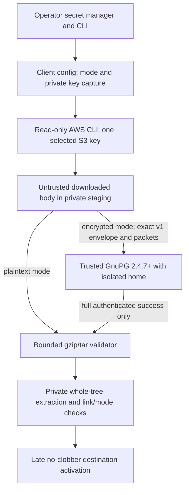

# Standalone Client Authenticated-Archive Threat Model

Status: implemented encrypted-client boundary under merged tasks #184-#187; approved #188 adds required real-GnuPG Test and Versioning gates. Publication of the new gate is not claimed before a passing post-merge release. Governing decision: [ADR-037](adr/ADR-037-authenticated-standalone-client-decryption.md), refining ADR-035 while preserving ADR-031's producer format.

## Security objectives and assets

The client must restore an entire validated certificate-state archive from one selected S3 object, with no S3 writes or ACME/Route53/issuer authority. Confidentiality-sensitive assets include the exported symmetric key, plaintext archive, account state, certificate private keys, private stage and destination. Integrity-sensitive assets include the versioned ciphertext, authenticated decrypted archive, filesystem topology, and exact shipped release identity.

## Trust boundaries

The encrypted path adds trusted GnuPG, its linked libraries, agent where used, local kernel/filesystem, and the operator's key distributor to the consumer trusted computing base. The AWS CLI and downloaded object are **not** trusted to establish archive contents. The version marker and packet inspection establish eligibility for decryption, **not authentication**; only successful complete AEAD decryption followed by ordinary archive validation authorizes extraction.

## Threat and failure matrix

| Threat or failure | Mitigation and verification requirement | Residual limitation |
| --- | --- | --- |
| Downgrade / incorrect mode | Key-based `auto` or explicit `none`/`gpg-ocb` selection; mismatch status 64 before read or status 65 after fetch; no second read or legacy fallback | An operator can deliberately change mode and object |
| Unknown/forged version, unsupported CFB/MDC/S2K, malformed packets | Exact `CERTBOTBOT-GPG-OCB-V1\n` envelope and version 5, AES cipher 9, OCB 2, S2K mode 3/SHA512 hash 10/count 16777216; reject unsupported extra packets; actual authenticated decrypt | Metadata is not separately AEAD-associated data |
| Wrong key, ciphertext modification or truncation | Complete authenticated GnuPG exit plus complete-file handling before tar validator; negative wrong-key and tamper tests | Valid older ciphertext can be replayed |
| Partial plaintext before authentication | Private staging only; no validator/extractor until final authentication; clean only client-owned staging on failure | Crash may strand private plaintext; deletion is not forensic erasure |
| Malicious or unsafe decrypted tar | Existing 32 MiB / 2,048 member limits, type/path/link/mode checks, complete multi-lineage validation and private activation | A correct symmetric key does not establish trusted certificate issuance |
| Secret from environment exposed to subprocesses or logs | Disable xtrace before capture; unexport; reject LF/CR; GnuPG FD 3 only; no CLI, literal `.env`, raw stderr or secret echo; assert secret sentinels absent | Initial environment, memory, same-UID processes and privileged host remain outside Bash guarantees |
| Compromised/incompatible GnuPG | Version >=2.4.7 plus real AES256/OCB roundtrip and packet-format probe in isolated 0700 home with `--no-options`; status 69 when missing | Installed binary/libraries/agent remain trusted dependencies |
| S3 read uncertainty or malicious content | Existing HeadObject/HeadBucket corroboration and exactly one GetObject; no Put/Delete or backup search | No S3 snapshot freshness or remote authenticity guarantee |
| Destination collision/escape | Existing secure owned parent, private sibling stage, full link/mode checks and late absent-target activation | Deliberate same-UID race unsupported |
| CI releases untested cryptographic client | Actual shipped eight-file bytes, checksums, real OCB fixtures, Bash 4.3, all producer and plaintext gates, attestation before late tag | CI is evidence, not a proof of defect absence |

## Required evidence by technical task

- **#185:** configuration precedence, allowed/forbidden combinations, key capture/unexport, no raw subprocess secret, absence of GnuPG requirements in plaintext, prefetch encrypted-mode capability probe and status classification.
- **#186:** exact packet/whole-ciphertext acceptance, protected authenticated staging, unchanged bounded tar validator, no-clobber activation and fail-closed cleanup on every abort.
- **#187:** black-box **shipped client** fixtures made with real supported GnuPG: correct key, wrong/missing key, tamper, truncation, unknown version, legacy/incorrect packet, malicious decrypted tar, multi-lineage preservation, existing destination, secret sentinel and no secondary AWS read.
- **#188:** dedicated unprivileged non-skippable GnuPG 2.4.7+ shipped-client Test/Versioning jobs, verified eight-file immutable handoff, explicit aggregate and publish gates, operator help/settings/examples and release attestation. Required skipped, missing or failed crypto evidence blocks publication.

## Non-goals and review triggers

No key generation, distribution, rotation, recovery, server installation, producer migration, alternate object selection, or cryptographic proof of certificate chain trust is supplied. Revisit this model for any new envelope version, changed GnuPG/S2K parameters, new runtime crypto dependency, new key source, added authority, different archive validator, target replacement semantics or release topology. The producer-specific [encryption threat model](archive-encryption-threat-model.md) continues to govern issuance and publication independently.

## Operator verification and key transition

The client and producer share the exact authoritative key and
format contract. The operator distributes and rotates high-entropy
secrets independently of GitHub Actions and outside the client CLI or
literal config. A new key must be coordinated with producer upload and
consumer retrieval; no downgrade, multi-key fallback, historical
version lookup or migration is offered to the client. See
[client settings](client-settings.md) and
[encrypted examples](examples/certbotbot-client.md).

The independent required Test/Versioning jobs may inspect *generated*
fixture secrets only inside private runner processes. The immutable
release handoff contains only executable binaries, checksums and its
private workflow manifest, never test workspace secrets. The verified
public release contains only eight executable/checksum assets, after
successful attestation and all quality gates.
