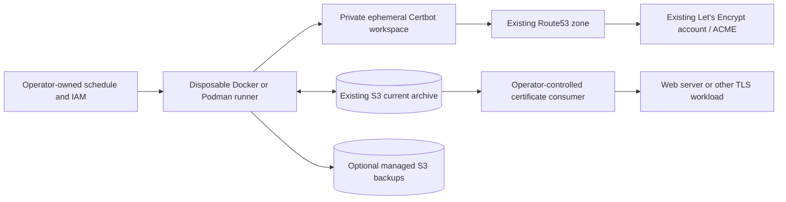

# Running certbotbot in an Ephemeral Container

This is the operator deployment and security guide for the **one-shot
certificate producer**. It covers the production [root Dockerfile](../Dockerfile)
and [Docker/rootless-Podman quick start](examples/docker-podman.md).
It is documentation for approved task [#157](https://github.com/wesley-dean/certbotbot/issues/157)
under story [#151](https://github.com/wesley-dean/certbotbot/issues/151).
Container image design and release trust are governed by
[ADR-038](adr/ADR-038-verified-oci-producer-images.md) as partially superseded
by the [Alpine 3.24 decision, ADR-039](adr/ADR-039-alpine-oci-runtime.md).
A successful local build does **not** establish registry publication or
live certificate-issuance acceptance.

## Architecture and responsibility boundaries

The **runner** executes `certbotbot.bash` in a short-lived process. The producer
reads an already-existing selected archive object from S3, validates and restores
the Certbot configuration/account and existing lineages into private
temporary storage, creates or renews the selected lineage through Certbot's
Route53 DNS-01 plugin as needed, verifies certificate material, and conditionally
writes the resulting archive and configured backup objects to S3. An archive
or remote publication failure must remain a nonzero job outcome.

The **certificate consumer** is a *different host or workflow*. It downloads
the validated S3 artifact, installs certificates into the service's own
configuration, and reloads or restarts that service as appropriate. The producer
does **not** install anything on a downstream web server, implement distributed
locking, run a scheduler, configure IAM, manage DNS zones, create a bucket,
register a Let's Encrypt account, or manage automatic target-host reloads.
The separate [read-only client](separate-client-contract.md) may retrieve and
extract the current object, but it is **not** bundled in the producer image and
does not itself install/reload certificates.



The durable authority is the **selected current S3 object**, normally
`latest.tar.gz`. The container filesystem and its restored account material
are intentionally disposable. A successful archive copy is **not** proof that
a remote consumer has installed or loaded the new certificate.

## Prerequisites and supported runtime

Before any real networked run, provision and independently verify:

1. An **existing** S3 bucket and current archive object with a valid
   Certbot state, including an **already registered** Let's Encrypt account.
   The producer does not seed the account, create a missing archive, or
   provision the bucket.
2. An existing Route53 hosted zone covering the DNS-01 challenges and an
   AWS identity with narrowly scoped S3 and Route53 permissions.
3. A trusted Linux/amd64 Docker engine or rootless Podman environment,
   DNS/network egress to AWS and ACME endpoints as required, and an
   operator-controlled scheduler with **no overlapping writers** for the
   same S3 current key.
4. For encrypted archives, a compatible GnuPG AES-256/OCB archive/key,
   and a securely supplied process-environment `GPG_SYMMETRIC_KEY`.
   Encryption migration has additional prerequisites; never select a
   migration mode as a generic recovery shortcut.

The production image currently targets **linux/amd64 only**, using the
pinned Alpine 3.24.3 base and v3.24 main/community package repositories.
The image includes Bash (at least 4.3), AWS CLI v2, Certbot and its
`dns-route53` plugin, OpenSSL, CA trust, GnuPG 2.4.7+ with tested
AES-256/OCB capability, and GNU tar/gzip/core and filesystem utilities.
Build-time checks test the actual runtime toolchain and record the
installed transitive APK package list at
`/usr/local/share/certbotbot/packages.lock`.

The Alpine base manifest is pinned, but compatible package updates are
permitted within the reviewed Alpine v3.24 family. **That does not
guarantee byte-for-byte reproducible future builds or absence of CVEs.**
A changed package set requires newly reviewed OCI identity and the same
Docker/Podman acceptance gates. Neither host engine is required for ordinary
standalone-Bash operation; containerization is an optional distribution.

## Container identity and state boundaries

The image has an exec-form entrypoint,
`/usr/local/bin/certbotbot.bash`, and defaults to `--help` with no
user arguments. Public flags and positional DNS names are passed **after**
the image reference, exactly as with the ordinary executable. There is
no image-specific wrapper or alternative configuration language.

The default user is **UID:GID 65532:65532**. `HOME`, `TMPDIR`, and
related cache/config directories reside under `/run/certbotbot`. Mount
that directory as a private, mode-0700, UID-writable **tmpfs** when using
a read-only root filesystem. Docker accepts explicit uid/gid tmpfs options;
rootless Podman's tested path instead uses `--mount ... U=true`.
Do **not** work around a permissions failure with a world-writable
directory or root/privileged execution.

Use `--read-only`, `--cap-drop=ALL`, and
`--security-opt=no-new-privileges`; provide no Docker/Podman socket,
host `/etc/letsencrypt` bind mount, extra Linux capabilities, or
persistent writable account directory. The OCI runtime is a process
isolation boundary, **not a virtual-machine confidentiality guarantee**:
privileged operators and engine/host administrators may still inspect
container environments and mounted files.

The image must never contain the operator's S3 archive, ACME account
material, certificate private keys, AWS credentials, or GPG secret.
Container build inputs are derived from the verified **eight-file**
producer/client/checksum handoff; only the ordinary producer is installed
in this image. See the [OCI build contract](oci-build-contract.md) and
[release-validation gate](oci-release-validation.md).

## Local non-production image smoke check

The following example produces a **local development image** from a
trusted checkout. It has no live AWS/ACME credentials, performs no
issuance/renewal, and does not authorize publication. The two engine
tests in CI exercise one transferred image; separate local builds under
different engines are not evidence that the resulting bytes are equal.

```bash
set -euo pipefail
VERSION=0.0.0-dev
SOURCE_COMMIT="$(git rev-parse --verify HEAD)"
make deps
make build "VERSION=$VERSION"
WORK="$(mktemp -d)"
CONTEXT="$WORK/context"  # must not exist before preparation
bash ci/prepare-oci-context.bash local dist "$CONTEXT" \
  "$SOURCE_COMMIT" 1 1 "$VERSION"
PRODUCER_SHA256="$(sed -n 's/^producer_sha256=//p' \
  "$CONTEXT/oci/producer/provenance.txt")"
HANDOFF_MANIFEST_SHA256="$(sed -n 's/^handoff_manifest_sha256=//p' \
  "$CONTEXT/oci/producer/provenance.txt")"
docker build --platform linux/amd64 \
  --build-arg "SOURCE_COMMIT=$SOURCE_COMMIT" \
  --build-arg "RELEASE_VERSION=$VERSION" \
  --build-arg "PRODUCER_SHA256=$PRODUCER_SHA256" \
  --build-arg "HANDOFF_MANIFEST_SHA256=$HANDOFF_MANIFEST_SHA256" \
  --build-arg BUILD_KIND=local -t certbotbot:local "$CONTEXT"
docker run --rm --pull=never --network=none --read-only \
  --cap-drop=ALL --security-opt=no-new-privileges \
  --tmpfs /run/certbotbot:rw,nosuid,nodev,uid=65532,gid=65532,mode=0700 \
  certbotbot:local --version
```

On a **rootless** Podman host, transfer the local Docker-built image with
`docker save` and `podman load` (or build separately for a local
development smoke check), then run:

```bash
podman info --format '{{.Host.Security.Rootless}}'  # require true
podman run --rm --pull=never --network=none --read-only \
  --cap-drop=ALL --security-opt=no-new-privileges \
  --mount type=tmpfs,destination=/run/certbotbot,tmpfs-mode=0700,U=true \
  certbotbot:local --help
```

Both tests disable networking intentionally. A production run cannot use
`--network=none` because AWS, DNS, and ACME endpoints must be reachable.
Remove the temporary `$WORK` directory and any exported image tar after
testing. See [the reviewed quick start](examples/docker-podman.md) for
complete side-by-side invocation, inspection, and image-transfer commands.

## Network and credential strategies

**Prefer workload identity** where the runner platform can provide a
short-lived AWS identity: instance/task/pod role, STS-based credentials, or
an equivalent trusted broker. The AWS CLI inside the container must be able
to reach whatever credential-provider endpoint that arrangement requires.
Restrict other outbound connections according to the operator's network
policy; there is no listening service port in the image.

Where a role is unavailable, a host/orchestrator secrets facility can
provide a restricted AWS shared-credentials file as a **read-only
runtime mount**. The nonsecret environment selector
`AWS_SHARED_CREDENTIALS_FILE=/run/secrets/aws-credentials` can point
the AWS CLI to it. The file must be readable by container UID 65532
without relaxing its intended confidentiality. Rootless Podman's user
namespace can map ownership differently from Docker's host; SELinux
enforcing hosts may need operator-approved *private* relabeling of
dedicated secret files. Never blindly relabel a shared/system secret,
mount a whole host home directory, or make credentials world-readable.

Configuration precedence for **nonsecret project settings** is
CLI > explicitly exported environment > literal selected `.env` >
default. An explicit `--config FILE` can select a read-only-mounted
literal nonsecret settings file. Files are parsed as data rather than
executed. Do not bake a `.env` into the image or build context.
`GPG_SYMMETRIC_KEY` is **only** an exported process environment secret;
it must not appear in command arguments, literal config files, Docker
build arguments, labels, images, logs, or checked-in examples.
Prefer orchestrator secret injection over an interactive shell history.
Remember that environment values can still be observed by privileged
host/container administrators. Rotate any key suspected of exposure
according to the operator's archive/key-migration policy.

Do not pass AWS credentials to a `docker build` or `podman build`
step. Building, linting, testing, attesting, and publishing OCI images
must never contact live production S3, Route53, or ACME endpoints.

## S3 and DNS permissions, publication, and recovery

Keep IAM authority tied to the *selected* bucket, key and hosted zone:

| Operation | IAM implications | Responsibility |
| --- | --- | --- |
| Head/check and retrieve current object | `s3:GetObject`, appropriate bucket visibility for HEAD and absent-object classification | Producer and optional separate consumer |
| Publish the validated current archive | `s3:PutObject` on the intended key | Producer only |
| Complete Route53 DNS-01 challenges | Scoped `route53:ChangeResourceRecordSets` plus the appropriate hosted-zone read/list/change-status permissions actually used by the plugin | Producer/Certbot only |
| Optional managed dated backup | Additional scoped `s3:HeadObject` behavior (via object read privileges), `s3:PutObject`, and applicable metadata/conditional-write capabilities | Producer only when enabled |
| Optional retention | `s3:ListBucket` (object listing) and narrowly constrained `s3:DeleteObject`, plus required object metadata reads | Producer only when enabled |

The precise policy depends on the bucket's versioning, encryption, Object
Lock, KMS, conditional-write behavior, and account policy. Check AWS's
actual authorization and required API operations in the intended account;
the example above is an operations map, **not** a deployable IAM policy or
claim of sufficient grants. Key templating freezes one UTC selection for
the invocation, and the current key remains authoritative even when
backups exist.

Only one producer should modify a selected current key at a time.
A container start does **not** grant a lock. Use an operator-owned
scheduler with concurrency control, avoid automatic overlapping retries,
and retain exit status and traceable run identity without logging
secrets. A no-renewal result may legitimately leave the remote archive
unchanged unless explicit upload-on-no-renewal behavior is selected.
Backups and retention are separately configured behaviors and may
partially succeed or fail; an S3 write and a downstream service reload
are never one atomic transaction.

The separately shipped [read-only client](separate-client-contract.md)
can retrieve one current object with a restricted read-only AWS identity
and validate/extract it to a new destination. It does not renew, enumerate
backups, delete S3 objects, deploy certificates or reload services.
Recovery from an uncertain producer failure should begin with
**independent inspection** of the authoritative current object and any
operator-managed backups/versioning, not by rerunning a destructive
retention or encryption migration blindly. Validate an archive before
installing it, and retain the previous known-good certificate until
the target workload has successfully activated the replacement.

## Operational failure checklist

| Symptom | Investigate without exposing secrets |
| --- | --- |
| Invalid arguments or no domain | Compare effective nonsecret settings against the documented public CLI; do not log secret environments |
| S3 current object is absent or cannot be read | Verify bucket/key, role permissions, HEAD/GetObject status and network; absent and unauthorized are distinct outcomes |
| Certbot DNS challenge fails | Check existing account, hosted-zone authority, allowed Route53 actions, propagation and outbound connectivity |
| Archive validation or GnuPG authentication fails | Stop, preserve known-good remote object, and validate archive format/key/source out-of-band; never accept plaintext fallback silently |
| Writable-workspace failure under Podman | Check rootless identity and private tmpfs `U=true` mount rather than granting root or broad write access |
| Renewal succeeds but S3 publication fails | Treat job as failed/uncertain remotely; do not assume either old or new object won without independent verification |
| Backup or retention fails | Evaluate the managed-object contract and remote state before retrying or deleting anything |
| Container exits zero but consumer still serves old certificate | Investigate the **separate** download/install/reload pipeline; producer success is not downstream activation evidence |

Run `--help` and `--version` as non-network preflights. Use the
[existing config and archive source contracts](decisions.md) for exact
flags, defaults, failure states, authenticated encryption requirements,
and managed S3 object rules. An ordinary container runtime does not
create a secure channel, a supply-chain signature, or a proof of certificate
issuance merely because its CLI returns zero.

## Production distribution and upgrade boundaries

The reviewed targets for a future dual-registry release are
`ghcr.io/wesley-dean/certbotbot` and
`docker.io/wesleydean/certbotbot`. **Do not assume either contains an
accepted published image yet.** Task [#165](https://github.com/wesley-dean/certbotbot/issues/165)
must publish only after successful source, attestation, release, no-push
image and security gates. Task [#166](https://github.com/wesley-dean/certbotbot/issues/166)
must verify both registry images, labels, digests, SBOM/provenance and
runtime parity. The currently pending upstream action compatibility work
is tracked in [publish_image #99](https://github.com/wesley-dean/publish_image/issues/99).

For production, retrieve a **reviewed immutable digest**
(`registry.example/namespace/certbotbot@sha256:<verified-digest>` is
a format placeholder), inspect `org.opencontainers.image.revision`,
`org.opencontainers.image.version`, producer SHA and supported platform,
and keep a known-good prior digest for rollback. Do not upgrade by
implicitly following a mutable `latest` tag. A new OCI image may
include updated Alpine packages even when its embedded Bash producer
is unchanged; track image revision and package inventory separately.

The image never provisions credentials, schedules itself, registers an ACME
account, starts a network service, or changes how the separately shipped
certificate client works. Its current approved DNS/storage integrations
are Route53/S3; alternative backends and archive formats must not be
inferred from container packaging.

## References

- [Docker/rootless-Podman quick start](examples/docker-podman.md)
- [OCI build contract](oci-build-contract.md)
- [Release-correlated no-push gate](oci-release-validation.md)
- [Standalone client contract](separate-client-contract.md)
- [Architectural decisions and applicable security ADRs](decisions.md)
- [ADR-038](adr/ADR-038-verified-oci-producer-images.md) and [ADR-039](adr/ADR-039-alpine-oci-runtime.md)
- [Full product documentation story #151](https://github.com/wesley-dean/certbotbot/issues/151), including the separate README rewrite task #152
