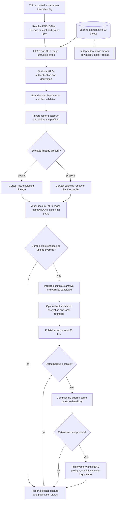

# How certbotbot Works

This guide describes the **currently assembled** certbotbot producer and its
state transitions, including selected-lineage renewal, additional SANs,
multiple preserved certificate lineages, encrypted archives, dated backups,
and conditional retention. It is a guide to the shipped interfaces, not a
new policy or a claim of successful live S3/Route53/ACME interoperability.

Start with [the public lifecycle contract](mvp-public-lifecycle.md) and
[decision map](decisions.md). The governing decisions are
[ADR-020 through ADR-028](decisions.md) for the initial state machine,
[ADR-029](adr/ADR-029-arbitrary-multi-san-selected-lineage.md) for SANs,
[ADR-030](adr/ADR-030-shared-archive-multiple-lineages.md) for stored
lineages, [ADR-031](adr/ADR-031-opt-in-authenticated-gpg-archive-encryption.md)
for encryption, [ADR-032](adr/ADR-032-deterministic-safe-archive-filename-templates.md)
for keys, [ADR-033](adr/ADR-033-opt-in-dated-backup-publication.md) for
backups, and [ADR-034](adr/ADR-034-scoped-conditional-managed-backup-retention.md)
for retention. The actual public command is in
[`src/main.bash`](../src/main.bash); lower-level contracts and tests
are linked at each stage.

## What the producer owns

One invocation selects **one certificate lineage** (one Certbot cert name)
and one **authoritative existing S3 current archive**. That archive can hold
an existing production ACME account plus multiple complete, independent
lineages. Selection never means "renew all" or "remove orphaned lineages":
unselected lineages must survive exactly as validated.

A fresh trusted runner needs Bash **4.3+**, AWS CLI v2, Certbot and its
Route53 DNS-01 plugin, GNU tar/gzip and filesystem utilities, OpenSSL, and
working GnuPG **2.4.7+ with authenticated OCB support** when encryption is
enabled. An already registered Let's Encrypt account and a **seeded S3
object** containing its valid archive state are prerequisites. The producer
does **not** create the S3 bucket, IAM role, Route53 hosted zone, first
archive, or ACME account.

Its work directory is private and temporary; the existing S3 current object
is the only persistent authority for certificate management. A target web
server is **not** operated or reloaded by the producer, and does not need
Certbot merely to serve an already installed certificate. Scheduling and
serializing writers are operator responsibilities.

## Execution and trust boundaries



Every arrow is conditional on the preceding stage succeeding. In
particular, a returned nonzero status stops intentional later
publication, but it cannot undo a remote operation that AWS may already
have accepted. The diagram separates *untrusted downloaded bytes* from
*restored state suitable to give Certbot*, and separates *local candidate
validation* from *remote acceptance*. No archive-sourced shell hooks
may execute.

## 1. Artifact and configuration identity

`make deps` obtains dependencies through pinned bashdeps;
`make deps-check` checks prepared inputs without network access;
`make build` assembles standalone producer executables offline using
the pinned `mktext` library. The three producer representations are:

| Product | Meaning |
| --- | --- |
| `certbotbot.dev.bash` | Development representation retaining documentation |
| `certbotbot.bash` | Ordinary, comment-stripped producer used by the OCI image |
| `certbotbot.min.bash` | Minified producer |

Every executable has a matching `.bash.sha256` companion, and the
separately shipped `certbotbot-client.bash` plus its sidecar make up
the **eight-file** release inventory. The read-only client is a
different product and is **not** a fourth producer flavor. Release
build/attestation rules are documented in
[release verification](release-verification.md) and the
[OCI build contract](oci-build-contract.md); downloading a file and
its same-source checksum alone is not proof of trusted release
provenance.

The producer resolves each ordinary setting with precedence
**CLI > explicitly exported environment > literal `.env` > default**.
`--config FILE` selects an explicit required literal configuration
file in place of optional `./.env`. It is parsed strictly as data,
not sourced as shell code; unknown/duplicate keys and shell evaluation
are rejected. `GPG_SYMMETRIC_KEY` is an exception: it is accepted only
as an **exported process-environment secret**, never as a project CLI
option or `.env` key. The entrypoint disables tracing before capturing
and unexporting it.

One primary DNS identity is supplied positionally or via `--domain`.
Canonical lowercase ASCII DNS names and an optional leading `*.`
wildcard are supported; the two primary forms conflict if both used.
`--san DNS_NAME` may repeat for additional unrelated names, or the
entire lower-tier `ADDITIONAL_SANS` comma-separated collection may be
used. CLI SAN entries **replace** lower-tier collections, never merge
with them. `INCLUDE_SUBDOMAINS=true` by default adds the complementary
apex/wildcard for **each** explicit name. The resulting list is
validated, deduplicated in stable order, and bounded to 100 names.
A certificate's exact DNS SAN *set* must match the requested set.
See [multi-SAN rules](multi-san-contract.md).

The stable selected `CERT_NAME` may be explicit; otherwise it derives
from the shortest textual requested SAN, with an ASCII lexical tie
break. It is **not** the S3 key. Selecting a different effective
name can target a different lineage; no Certbot `-0001` suffix
or hidden rename is authorized. Explicit naming is useful when
SANs evolve. See [MVP configuration](mvp-configuration.md) and
[certificate naming](mvp-certificate-naming.md). A full flag-by-flag
reference is tracked by [task #154](https://github.com/wesley-dean/certbotbot/issues/154).

## 2. Freeze key selection and fetch the seeded object

S3 bucket is required. The default **literal** current key is
`latest.tar.gz`. `--s3-key` supplies a literal key; the alternative
`--s3-key-template` renders `{YEAR}`, `{MONTH}`, and `{DOM}`
against one frozen UTC date. Both forms defined at the winning
configuration tier are an error. A template is a restricted single
filename component, not a path, shell expression, or arbitrary
`mktext` program. Filename template resolution does not enable backups
or migrate old keys. See [filename contract](archive-filename-template-contract.md).

The S3 adapter issues `HeadObject` for the exact existing key, then
stages nonempty `GetObject` bytes privately. A HeadObject 404 is
only a confirmed missing object if `HeadBucket` also succeeds.
Access denial, transport ambiguity, missing object, and failed/partial
download cannot trigger creation of an empty archive or fallback to
host `/etc/letsencrypt`. A successful GET is **not** validation of the
archive's contents and is not an atomic S3 snapshot. See
[S3 read boundary](mvp-s3-read.md) and
[retrieval failure matrix](mvp-s3-retrieval-failure-matrix.md).

## 3. Authenticate and validate archive state

The durable plaintext wire format is a gzip-compressed GNU tar of the
**contents** of `/etc/letsencrypt`, not `/etc` or an absolute
`/etc/letsencrypt` tar prefix. A representative state contains:

```text
accounts/acme-v02.api.letsencrypt.org/directory/<account-id>/
  private_key.json, regr.json, meta.json
renewal/example.com.conf
live/example.com/{cert,chain,fullchain,privkey}.pem
archive/example.com/{cert1,chain1,fullchain1,privkey1}.pem
renewal/unrelated.org.conf
live/unrelated.org/...
archive/unrelated.org/...
```

The `live` PEM names are canonical **relative links** to their own
versioned `archive/<lineage>` files. Stored renewal paths are canonical
`/etc/letsencrypt` references, not runner-local paths. The
validator rejects traversal, absolute paths, escape/cross-lineage
symlinks, hardlinks and unsupported special file types, unbounded or
duplicated entries, unexpected executable hook content, unsafe
permissions and inconsistent lineage triplets. This is bounded
format/structure validation, not permission to execute archive content.
See [archive layout](mvp-archive-layout.md) and
[archive restoration](mvp-state-preflight.md).

The invocation owns a fresh, canonical, mode-0700 workspace with separate
`config/`, `work/`, and `logs/`. It extracts only after safe
preflight, checks one supported existing production ACME account, and
validates **every** stored lineage, including unselected ones.
Incomplete unselected lineages or cross-lineage links fail before
Certbot. An account-only archive (no lineages) is valid for issuing
the first selected certificate; a missing account is not. Certbot's
canonical persisted renewal paths are mapped into private runtime
paths only for the selected lineage and restored to canonical values
before publication. See
[shared-lineage contract](multi-lineage-contract.md) and
[renewal path mapping](mvp-renewal-mapping.md).

When encryption is selected, the S3 bytes first contain the literal
`CERTBOTBOT-GPG-OCB-V1` envelope header followed by authenticated
GnuPG AES-256/OCB ciphertext wrapping the complete gzip/tar. The
implementation must authenticate before permitting plaintext to enter
the normal archive validator. Wrong keys, corrupt/unknown envelope,
missing expected encryption, or unsupported GnuPG fail **without
plaintext fallback**. Mode `auto` chooses encryption by presence of the
exported key; `none` combined with a key is an error. The key is
passed to GnuPG over a private FD, not shell arguments, subprocess
environment, log output, or tracked file. See
[encryption contract](archive-encryption-contract.md) and
[encryption threat model](archive-encryption-threat-model.md).

Explicit `--archive-migration plaintext-to-gpg-ocb` is a
one-directional operator-approved change with a suitable key and a
**separately confirmed recoverable pre-migration backup**. The
`--archive-migration-backup-confirmed true` flag records operator
acknowledgment; certbotbot does not prove that the old backup exists.
No implicit migration, rename to `.enc`, downgrade, rollback, or
second durable archive is performed.

## 4. Operate on the selected lineage only

With the supported restored account and no selected lineage, Certbot
issues it through the Route53 DNS-01 authenticator, requesting the
exact selected SAN set. With an existing complete lineage, the
producer checks its current DNS SANs. Matching SANs use
`certbot renew --cert-name NAME` with normal due/no-op behavior;
a valid different SAN set uses selected
`certbot certonly --renew-with-new-domains` for reconciliation.
The expanded multi-SAN contract permits unrelated DNS zones in one
certificate. Neither path invokes global `renew`, `renew-all`,
`remove-orphans`, archive hooks, automatic account registration,
or new Certbot lineage suffixes.

Certbot receives explicit private `--config-dir`, `--work-dir`,
and `--logs-dir`, selected registered account where required,
production ACME server, and noninteractive Route53 settings. Certbot
and the AWS CLI are **trusted external tools**, not hardened
sandbox boundaries. Remote issuance/renewal side effects can occur
before a local failure; that never authorizes a failed candidate's
S3 publication.

After provider success, the public lifecycle revalidates the original
account identity, selected lineage structure, every unselected lineage,
and the fact that unselected state did not change. It checks:
the selected DNS SANs exactly; current certificate validity; parseable
certificate and chain; leaf/private-key public-key equality; a fullchain
whose first certificate matches the leaf; and canonical persisted
renewal paths. Success of Certbot's subprocess alone is insufficient.
See [selected renewal](mvp-selected-renewal.md),
[SAN reconciliation](multi-san-contract.md),
[certificate verification](mvp-public-lifecycle.md),
and [multiple-lineage preservation](multi-lineage-contract.md).

The provider separately reports whether certificate bytes changed and
whether any **durable** canonical state changed (including account
metadata). A successful Certbot no-op can still require publication if
other durable state changed; a truly unchanged no-op does not.

## 5. Validate the complete candidate and publish current state

For a verified durable change, an explicitly requested
`UPLOAD_NO_RENEWAL=true` successful no-op, or an approved encryption
migration, the publisher packages the **whole** restored Certbot
configuration, not only the selected lineage. It uses private staging,
sorted GNU tar/ustar members and gzip, preserving canonical relative
links, account files, and supported unselected lineage history; it
re-runs archive validation before the destination candidate is used.
Encrypted mode authenticates the complete payload and validates
local decrypt/compare before the remote write. See
[candidate packaging](mvp-archive-packaging.md).

| Local outcome | Current-key PutObject | Public interpretation |
| --- | --- | --- |
| Successful unchanged no-op, override false | **None** | Success, `published=false` |
| Successful durable change | One accepted write required | Success only after AWS reports accepted write |
| Successful unchanged no-op, override true | Verified republish | Success when accepted |
| Failed read, restore, Certbot or local validation | **None intentionally** | Nonzero; no later publish stage |
| PutObject error/ambiguous response | Cannot infer remote result | Nonzero; inspect remote state independently |

The current writer targets **exactly the same resolved bucket/key** used
for the read. It supplies a SHA-256 checksum algorithm to the S3
PutObject API, but neither the CLI exit code nor a remote ETag alone
proves end-to-end replication or remote byte identity. A failed or
interrupted PutObject may have been accepted remotely; a nonzero
response is **not** proof that the previous object is intact. There is
no distributed transaction, automatic S3 rollback, or object-version
reconciliation. The operator must serialize writers and retain an
independent recovery plan. See
[S3 publication boundary](mvp-s3-publication.md),
[no-renewal policy](mvp-upload-no-renewal-policy.md), and
[failure-preservation matrix](mvp-failure-preservation.md).

## 6. Optional dated backup publication

`DATED_BACKUP_ENABLED=false` by default. When enabled and a
validated current-key upload is required, the producer may also
publish the **same archive candidate bytes** to a different dated
backup key. The default template is
`archive-{YEAR}{MONTH}{DOM}.tar.gz`, such as
`archive-20261025.tar.gz` on the frozen UTC date.
Configuring a backup template **alone** does not enable backup
publication. A normal unchanged no-op publishes neither object.

Before any current write, the backup destination and its conditional
write capabilities must pass preflight. An absent dated key uses
`If-None-Match: *`. An already managed key can be conditionally
replaced on the **same UTC date** only after verifying its expected
v1 metadata (schema, date, current-key hash, format, encryption mode)
and ETag, then using `If-Match`. An accepted backup PutObject is
confirmed by exact-key HEAD metadata/length; this is not a
cross-object atomic transaction or full remote re-download.
A failure after current publication reports nonzero **partial
success** and does not automatically undo that accepted current write.
See [dated backup contract](dated-backup-publication-contract.md)
and [recovery verification](dated-backup-recovery-verification.md).

## 7. Optional scoped retention

`BACKUP_RETENTION_COUNT=0` by default: no listing or deletion.
An explicit positive integer (1–10000) requires enabled dated
publication, a supported S3/tar.gz backend and an eligible restricted
date-shaped backup template. Retention is eligible **only after**
both a new current publication and its corresponding dated backup
have succeeded and the backup has been confirmed. It never runs
after a no-op, uncertain current/backup PUT, or invalid preflight.

The planner enumerates only the validated bucket/prefix with
complete bounded ListObjectsV2 pagination, parses exact date-shaped
keys, and HEAD-checks **every** matching candidate for approved v1
managed metadata, positive size, date and ETag. Ambiguous ownership,
incomplete pages, uncertain HEAD or malformed candidates stop the
operation **before any deletion**. The eligible backups are ordered
by the UTC date *encoded in their names*, not S3 LastModified. Keep
the newest N visible eligible keys; delete older ones individually
with exact-key ETag-conditional `DeleteObject`, stopping on the
first failed/uncertain response. The current key is never a
retention target. A failed later delete cannot undo earlier accepted
deletes or successful current/dated publication.

This does not delete S3 object versions, reclaim a guaranteed amount
of storage, prove object ownership from metadata alone, or protect
against concurrent independent writers. See
[managed retention contract](managed-backup-retention-policy.md),
[safety verification](retention-safety-verification.md) and
[ADR-034](adr/ADR-034-scoped-conditional-managed-backup-retention.md).

## 8. Operator outputs and failure recovery

The successful producer line identifies whether the selected name was
`issued` or `checked`, the nonsecret selected S3 identity, and
`published=true|false`. Enabled backups add
`backup=confirmed|skipped`. Enabled positive retention adds
`retention=completed|skipped` and a confirmed delete count. These
fields report the producer's **observed stages**, not downstream
installation, service reload or cloud transactional guarantees.

Useful public exit classifications are:

| Status | Meaning |
| --- | --- |
| 0 | Completed selected lifecycle; a verified no-op is valid success |
| 64 | Invalid command, selected identity, configuration or private workspace |
| 65 | Unsafe/incomplete archive, account, lineage or candidate certificate state |
| 66 | Seeded current S3 object positively confirmed absent |
| 69 | Required provider/tool unavailable or ambiguous remote service/authorization |
| 74 | Failed staging, provider operation or S3 transfer |

Specific adapters preserve stage status; not every failure collapses
to one code. External stdout/stderr from AWS, Certbot, OpenSSL and
GnuPG is not intended to become public diagnostics; diagnostic
messages are bounded and should not reveal archived credentials.
The invocation removes only its owned temporary workspace on
normal exit and signal-handled termination; this is not a secure
erase guarantee against a hostile host or unexpected kernel failure.

If a run fails **before** the current PUT, do not assume an issue
was attempted or an archive mutated: inspect the returned stage and
the operator's own logs. If PUT was attempted, inspect and validate
the actual current object independently; do not infer remote
byte preservation from an error, from an ETag, or from the old
runner's local files. If a dated backup was successfully confirmed
but retention later failed, handle that as partial success; never
retry destructive cleanup blindly. Recovery is an **explicit
operator-directed** action using a known-good archived copy,
independent validation, and coordinated replacement. Selecting a
historical backup key as the producer's `--s3-key` is **not**
read-only recovery.

Production IAM should restrict current-key GET/PUT, conditional
dated-backup writes, date-scoped list/delete only when enabled,
and Route53 challenge operations to intended zones. The source
process cannot verify operator IAM quality or enforce an S3
single-writer lock. Protect credentials, archive/private keys,
secret-managed GPG material and all live consumer systems from
untrusted runners. See [threat model](mvp-certificate-state-threat-model.md)
and [container deployment guidance](container-deployment.md).

## 9. Separate read-only certificate client and consumers

The built `certbotbot-client.bash` is a **separately shipped**
read-only consumer, **not** an option of the producer and not
packaged into its OCI image. It selects the operator's one current
bucket/key, validates the entire archive, optionally authenticates
the supported GPG-OCB envelope with a supplied exported secret,
and extracts into a new protected destination. It does not call
Certbot, Route53, ACME, PutObject, DeleteObject, automatic backups,
renew-all, install, or reload. A target host still owns the last
deployment step and its rollback strategy.

The client is present in the current eight-file release build
contract, and its real-GnuPG authenticated black-box CI gate is
required in both Test and Versioning. This **supersedes the stale
"standalone client not implemented" note** in the original task
#153 description; the note predates completed client tasks.
A passing required gate does not assert successful integration
with an operator's live bucket or service.

See [client contract](separate-client-contract.md),
[client settings](client-settings.md),
[client example](examples/certbotbot-client.md),
[client encryption threat model](client-encryption-threat-model.md),
and [release verification](release-verification.md).

## 10. Boundaries and evidence

The following remain **unsupported or unproven** by these
producer/consumer contracts:

- Registering a new Let's Encrypt account automatically, creating
  S3 buckets/IAM/zones, or bootstrapping a missing current object
- Automatic renewal of all lineages, deletion of orphaned lineages,
  global Certbot renewal, and implicit removal of old credentials
- Storage backends other than **S3**, DNS-01 providers other than
  **Route53**, and archive types other than **gzip tar** (with
  optional authenticated GnuPG envelope)
- In-image scheduling, certificate-serving daemon, automatic
  target-host installation/reload, distributed locks, automatic
  rollback or S3 version-ID cleanup
- Proven live S3/ACME/Route53 interoperability merely because
  mock-driven Bats, OCI smoke checks or artifact tests pass
- General multi-architecture OCI support: the current image is
  `linux/amd64` until another architecture passes native/emulated
  build *and runtime* acceptance
- Verified GHCR/Docker Hub distribution: release-correlated
  no-push gate [#164](https://github.com/wesley-dean/certbotbot/issues/164)
  and dual-registry publication/parity
  [#165](https://github.com/wesley-dean/certbotbot/issues/165) /
  [#166](https://github.com/wesley-dean/certbotbot/issues/166)
  have separate acceptance obligations; do not equate a committed
  workflow with verified live registry publication

The implementation is exercised by Bats against all three
producer artifacts with controlled AWS/Certbot fixtures and
real local cryptographic/archive tools where available. Relevant
evidence includes [fresh-runner continuity](mvp-fresh-runner-continuity.md),
[S3 roundtrip/fault validation](mvp-s3-roundtrip-validation.md),
[encryption verification](archive-encryption-verification.md),
[multi-lineage verification](multi-lineage-verification.md),
[retention verification](retention-safety-verification.md),
and [OCI runtime acceptance](../tests/oci-runtime.bash).
Mocked external commands prove the local contract, not external
service conformance.

For deployment, begin with
[the Docker/rootless-Podman quick start](examples/docker-podman.md)
and [operator guide](container-deployment.md).
For public settings, use
[the configuration implementation](../lib/config.bash),
[config contract](mvp-configuration.md),
and eventually the full reference approved under
[task #154](https://github.com/wesley-dean/certbotbot/issues/154).
