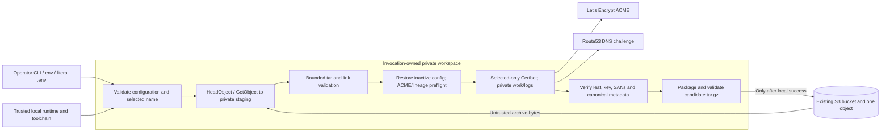

# MVP Certificate-State Threat Model

Status: scoped review for approved technical task #33 (parent story #10).
This records the existing security architecture and evidence; it does not
authorize new behavior or supersede Accepted ADRs. Review alongside
[the threat-modeling method](threat-modeling.md), the [decision map](decisions.md),
and ADR-015, ADR-016, and ADR-020 through ADR-028.

## Scope and Security Objectives

The MVP processes **one selected certificate lineage** in **one pre-existing
unencrypted S3 tar.gz object** under an existing Let's Encrypt production
account. It runs as a standalone Bash script on an ephemeral host using
operator-installed AWS CLI v2, Certbot with Route53 DNS-01, GNU tar/gzip,
OpenSSL and standard filesystem utilities.

The bounded security objectives are:

1. Never infer an empty initial state from unavailable remote state. A missing
   whole archive is a fatal prerequisite failure, even when absence is proven.
2. Never activate archive content until format, paths, links, size, privacy
   and account/lineage metadata have passed distinct local validation gates.
3. Issue, reconcile or renew only the verified selected Certbot identity with
   its pre-existing account, using private config/work/log roots.
4. Never intentionally replace the authoritative remote object with state
   from a failed provider, unsafe restore, failed package or invalid candidate.
5. Keep account/private-key bytes and raw AWS/Certbot/OpenSSL diagnostics out
   of normal stdout/stderr; restrict owned local workspaces and remove them at
   process exit.
6. Make success, no-op, failed transfer and uncertain remote publication
   outcomes distinguishable without claiming cross-host atomicity.

These are goals bounded by the supported platform, honest operator inputs,
trusted installed tools and the currently tested single-writer assumption.
They do **not** imply that Bash can sandbox a hostile local executable.

## Assets and Authority

| Asset | Primary concern | Owner / scope |
| --- | --- | --- |
| ACME account key, registration and identity | Confidentiality, integrity, availability | Restored archive and private runner config |
| Certificate private key and certificate chain | Confidentiality, integrity, selection | Selected lineage under private config; published S3 object |
| Canonical renewal metadata and live PEM links | Integrity and portability | Relative archive state; canonical `/etc/letsencrypt` paths |
| Seeded, last-known-good S3 object | Integrity and availability | Operator-selected existing bucket and exact key |
| AWS credentials, IAM and Route53 permissions | Least privilege and secret handling | Operator/cloud SDK context, **not** archive members |
| CLI flags, environment and literal .env | Correct interpretation and scope | Operator-controlled configuration |
| Private invocation workspace and tar staging | Local confidentiality and cleanup | Current invoking process and account |
| Built Bash artifacts, pinned build tools and CI | Supply-chain integrity | Trusted build/review/release workflow |
| Terminal output and operational records | Secret disclosure and truthful status | Bounded diagnostics and result status |

The plaintext tar.gz contains certificate and ACME account secrets, so
**archive access is secret access**. Application-level archive encryption is
outside MVP scope; no statement in this document guarantees configured S3
encryption-at-rest, cloud credential isolation, or remote version retention.

## Trusted Computing Base and Operator Preconditions

The trusted computing base includes the Bash 4.3+ runtime, assembled project
source, the installed `aws`, `certbot`, Route53 authenticator, `openssl`,
`tar`, `gzip`, `stat`, `mktemp`, `sha256sum`, and filesystem/kernel
behavior. The external AWS, Route53 and ACME services must operate according
to their API contracts. Build-time trust additionally includes pinned bashdeps,
Bash-Minifier, Doxygen tooling, CI actions and the source/release process
(ADR-005, ADR-006, ADR-015).

The operator must provide an existing bucket and correctly seeded object
with a registered production Let's Encrypt account; valid credentials; a
trustworthy invocation host and toolchain; and **serial execution** for writers
to the same S3 object. Required S3 capabilities are appropriately scoped
`s3:ListBucket` (bucket), `s3:GetObject` and `s3:PutObject` (selected
object). Certbot's Route53 plugin also requires separately scoped DNS
challenge permissions. The application does not provision, inspect or prove
the least-privilege quality of those permissions and does not create accounts,
buckets, IAM roles or DNS zones.

`--config-dir`, `--work-dir` and `--logs-dir` are invocation-private.
The host's `/etc/letsencrypt` is **not** used as recovery state. A malicious
program running under the same UID (or with sufficient privilege), a
compromised AWS CLI or Certbot executable, and independently racing S3
writers are outside the isolation/rollback guarantees.

## Trust Boundaries and Data Flow

The diagram describes *policy and authority* boundaries, not a guarantee
that any subprocess is contained by a security sandbox. Significant crossings:

- **Operator to parser:** CLI beats environment, then literal .env, then
  defaults. .env content remains data; it is not sourced or evaluated.
  Selected certificate names and S3 keys remain distinct.
- **Cloud to local filesystem:** HeadObject/GetObject output is initially
  untrusted. HeadObject 404 plus successful HeadBucket classifies missing
  state; other access/transport failures are unavailable, never bootstrap.
- **Tar to active Certbot configuration:** Validation precedes extraction;
  only the accepted relative archive layout, supported member types and
  bounded live symlinks may enter the private config tree. Preflight then
  requires exactly the accepted production account and selected lineage.
- **Config to privileged subprocess:** Certbot sees the chosen account and
  exact selected lineage with disabled archived directory hooks. Canonical
  renewal paths are reversibly mapped during runtime, not permanently
  replaced with runner-local paths in the published object.
- **Verified local state to authoritative S3:** A completed provider call
  is necessary but insufficient. Selected certificate/key, SAN and metadata
  checks precede validated candidate packaging and any PutObject.
- **Secrets to stdout/stderr:** Raw subprocess output is suppressed at
  project-owned boundaries. Fixed diagnostics and a non-secret selected
  key/status replace raw cloud and certificate content. A compromised
  installed tool or host-level logging can still expose secrets.

## Threat Actors, Failures and Mitigations

| Boundary / failure | Mitigation and evidence | Residual risk / non-promise |
| --- | --- | --- |
| Malformed CLI, literal .env or ambiguous selected name | Bounded parser, validated identity and explicit precedence; config-identity Bats | Host environment and tool binaries remain trusted |
| S3 403, expired token, timeout, service error or unknown 404 | Distinct 69 unavailable / 66 proven missing classification; public S3 retrieval matrix | AWS response strings are not a structured authenticated proof of absence |
| Missing entire S3 object | Fatal 66, no account bootstrap, Certbot or PutObject | Operator must restore/seed the object out of band |
| Truncated, malicious or decompression-bomb tar | Pre-extraction format/member/expansion guard and private restore; archive/layout Bats | No claim that GNU tar or the host kernel is sandboxed |
| Traversal, hardlinks, escaping symlinks, devices or executable hooks | Restrictive validated archive dialect; rejection before Certbot; disabled hooks | Novel Certbot archive dialects require separate review |
| Missing, competing or mismatched ACME account or lineage | Read-only preflight plus Certbot selected account check; state Bats | Local file checks do not authenticate remote ACME account availability |
| Wrong account/provider or unintended mass renewal | Fixed production endpoint, `dns-route53`, exact `--cert-name`, no implicit registration or global renew | Operator's installed executable and credentials retain their authority |
| Failed Certbot, unexpected SANs or wrong key | No publication until post-provider leaf/key/SAN and metadata verification | Local leaf validation does not establish chain trust or revocation status |
| Partial package, bad gzip or unvalidated candidate | Candidate in private temp; verify before `put-object`; package and roundtrip Bats | Interruption may leave local staging until EXIT cleanup runs |
| AWS PutObject rejected before accepting bytes | Nonzero; mock remote bytes unchanged | Service behavior must be verified in live acceptance |
| AWS PutObject accepts bytes then response is lost | Nonzero; public report says remote status uncertain | Cannot assert remote bytes unchanged, retry safety, or rollback |
| Concurrent writers or remote object deletion | Require out-of-band writer serialization and scoped IAM | No distributed lock, CAS, historical backup or cross-runner transaction |
| Private keys on local disk, CI logs, S3 | 0700 workspace, private selected keys and static diagnostics; negative Bats assertions | Unencrypted S3 object, host admins, runtime tools and operator logs remain trusted |
| Compromised dependencies, generated artifacts or CI | Pinned acquisition, artifact hashes, all-flavor Bats, review and lint/code checks | Checksums alone do not prove dependency or build behavior safe |

## Fail-Closed Lifecycle and Exit Semantics

| Stage or state | Next authorized operation | Exit/result if failed | May intentionally PutObject? |
| --- | --- | --- | --- |
| Unresolved or invalid input / workspace | Reject before AWS and Certbot | 64 or other defined invalid-input status | No |
| Absent seeded S3 object (proven) | Stop | 66 | No |
| Unavailable S3 state or AWS CLI | Stop | 69 | No |
| Transfer or private staging failure | Stop and clean staging | 74 | No |
| Unsafe archive, incompatible account or lineage | Stop before Certbot | Nonzero, typically 65 | No |
| Unrecognized Certbot/provider or issuance/renewal failure | Stop; discard local state | Provider-defined nonzero | No |
| Post-provider certificate, SAN, key or metadata invalid | Stop; discard local state | Nonzero, typically 65 | No |
| Local candidate packaging / validation failure | Stop; discard candidate | Nonzero, often 65/74 | No |
| Verified unchanged durable state; override false | Report successful no-op | 0; `published=false` | No |
| Verified changed state or successful forced republish | Build validated candidate; perform one PutObject | 0 **only if** PutObject succeeded | Yes, exact retrieved key |
| PutObject failed or response lost | Report failure and uncertain remote state | Nonzero, typically 74 | Already attempted; remote result unknown |

The code may return other stage-specific nonzero values. The table is a
security decision map, **not** a claim of an exhaustive numeric API. An
interrupt/termination may yield signal-derived status and cleanup attempts.
The invariant is that **pre-PutObject failures do not authorize a write**.
Once a PutObject is attempted, application code cannot establish rollback
or whether a lost response followed remote acceptance.

This ordering depends on all adapters staying inside their defined
responsibilities. No future refactor may treat Certbot's zero exit as
sufficient evidence of a valid certificate or assume a successful download
is trusted until tar and ACME preflight gates pass.

## Security Acceptance Evidence and Gaps

- **Configuration and identity:** `tests/config-identity.bats` covers
  invalid/double inputs, precedence and selected apex/wildcard behavior.
- **Unsafe archive and private restoration:** `tests/archive-layout.bats`,
  `tests/archive-restore.bats` and `tests/state-preflight.bats` cover
  rejected paths/members, private directory constraints, incomplete account
  material, foreign lineage and hook references.
- **S3 and publication fault boundaries:** `tests/s3-read.bats`,
  `tests/s3-publish.bats` and `tests/public-lifecycle.bats` cover
  403/404 classification, partial GetObject, invalid compressed data,
  pre-write suppression, unknown PutObject outcome and fresh-runner continuity.
  Task #33 adds a public-entrypoint secret-output regression.
- **Three artifact flavors and Bash runtime:** CI `make test` runs Bats
  against development, stripped and minified outputs; compatibility CI checks
  Bash 4.3. Build outputs include SHA-256 companion files.
- **Mock boundary:** Bats exercises real local OpenSSL and tar/gzip, but
  mocks AWS CLI and Certbot/Route53. Live S3/ACME/DNS integration, remote
  account suitability, policy permissions and cancellation/race behavior are
  **not demonstrated** by these tests; milestone #4 governs live staging.

Passing tests support the documented narrow behavior and do not confer
an unconditional confidentiality, availability or recovery guarantee.

## Non-Goals and Review Triggers

MVP does not provide client-side encryption, backup versions or retention,
distributed locking, remote write rollback, multiple simultaneous lineages,
ACME account registration, privilege separation, hostile local-tool sandboxing,
global renewal, or proof of external DNS/ACME interoperability.

Revisit this model before accepting a change to archive encryption, extra
lineages, `RENEW_ALL`, `REMOVE_ORPHANS`, storage/DNS backends, hook
execution, credential scopes, S3 key selection, restoration validation, tar
member dialects, logging, external dependencies, build/release authority or
cleanup handling. New behavior with changed trust/authority boundaries needs
an Accepted ADR and a corresponding entry in `doc/decisions.md` under the
repository's three-phase development governance.

## Governing Sources

- ADR-015 and ADR-016: dependency/trust review and threat modeling.
- ADR-020 and ADR-021: seeded object, selected identity, classified S3 read.
- ADR-022 and ADR-023: archive dialect, private restore, account preflight.
- ADR-024 through ADR-026: selected Certbot execution, renewal and SAN drift.
- ADR-027 and ADR-028: validated candidate, same-key PutObject and no-op truth table.
- [Public lifecycle specification](mvp-public-lifecycle.md).
- [S3 retrieval failure matrix](mvp-s3-retrieval-failure-matrix.md).
- [S3 roundtrip and publication fault evidence](mvp-s3-roundtrip-validation.md).
