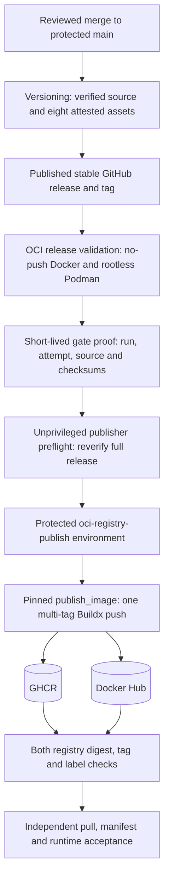

# Publishing and Operating certbotbot OCI Images

This is the maintainer and operator publication guide for the
**one-shot certbotbot certificate producer**. It complements the
[end-user container deployment guide](container-deployment.md), the
[Docker and rootless Podman examples](examples/docker-podman.md), and
the [verified publication contract](oci-publication-contract.md).
The separate read-only certificate client is **not** included in
these images.

The governing decisions are
[ADR-038](adr/ADR-038-verified-oci-producer-images.md),
[ADR-039](adr/ADR-039-alpine-oci-runtime.md), and
[ADR-040](adr/ADR-040-release-gated-dual-registry-oci-publication.md).
This guide describes the reviewed implementation, not a second
independent release mechanism.

## Responsibilities and supported distribution

| Component | Responsibility |
| --- | --- |
| GitHub Versioning workflow | Test, attest, and publish eight standalone Bash assets from a reviewed source revision |
| OCI release validation | Bind the signed source and release assets to a no-push OCI image; exercise Docker and rootless Podman without publishing secrets |
| Protected publisher | Reverify the release; build and push the same image to GHCR and Docker Hub with the pinned `publish_image` action |
| Post-push checks | Read both registries' tags and immutable manifests; verify image digest, platform, source and producer identity |
| Independent pulled-image acceptance | Retrieve the published image by digest, verify OCI attestation descriptors, run under Docker and rootless Podman, compare package inventories |
| Certificate operator | Supply existing S3, Route53, ACME, IAM, scheduling and certificate-installation infrastructure |

The image is currently **Linux/amd64 only** and runs as
**UID:GID 65532:65532**. Its root filesystem can be read-only,
provided that `/run/certbotbot` is a private writable tmpfs.
The runtime uses the selected Alpine 3.24 release family and the
ordinary verified `certbotbot.bash` artifact. The producer does not
register a Let's Encrypt account, configure AWS, schedule renewals,
install certificates on another host, or run a certificate server.

Both publication destinations are explicit:

- GHCR: `ghcr.io/wesley-dean/certbotbot`
- Docker Hub: `docker.io/wesleydean/certbotbot`

These names are **not** interchangeable. In particular, the Docker
Hub namespace is `wesleydean`, without a hyphen. Docker Hub
visibility is managed on Docker Hub; GHCR package visibility and
access are managed separately on GitHub. Public pull access is an
operator-owned registry setting, not an effect of a successful push.

## How automatic publication works

The enabled
[`publish-image.yml` workflow](../.github/workflows/publish-image.yml)
publishes automatically after a successfully validated stable release.
There is **no separate repository enablement variable**. Disable the
workflow if automatic publishing is not intended.

The event chain is **Versioning → OCI release validation →
Publish verified certbotbot OCI image**. The two downstream workflows
listen for completed `workflow_run` events; they do not rely on tag
or release events from a release created using `GITHUB_TOKEN`.
Such token-created tag/release events cannot be assumed to trigger
additional workflows.

The no-push OCI gate checks the upstream Versioning run, signed
commit, correct source/tag, all eight GitHub-attested release assets,
verified checksums and supported runtime. Its short-lived proof
records the actual successful run and attempt. It is **untrusted
locator data**, not a cryptographic attestation or a source of
independent authority.

The publisher preflight rechecks that proof against the originating
Versioning run and GitHub's current latest stable release. The
protected publisher job independently rechecks the release and uses
an allowlisted build context. It invokes the reviewed immutable
`wesley-dean/publish_image` commit recorded in the
[publication workflow](../.github/workflows/publish-image.yml).
The workflow permits only the verified release ref and original
source SHA, not the ambient `workflow_run` default-branch ref.
A delayed, superseded release must fail rather than update `latest`.

Successful pushes are followed by verification of **both** registry
references, the same image digest and required tags, `linux/amd64`,
and the original source and ordinary producer checksum labels.
A separate, read-only, post-publication job then checks index
structure, SBOM/provenance descriptor presence and binding, actual
pulled-image runtime and installed-package parity. It runs each
registry image with Docker and rootless Podman. The post-push and
pulled-image acceptance jobs are required for successful overall
publication.

Nothing in this chain issues live certificates or accesses
production S3/Route53/ACME. The publication credentials do not
enter the producer's OCI build inputs or runtime.

## Configure registry access once

These steps require an administrator with authority over the
GitHub repository, its environments, and the two registry
destinations. Protect the branch and the publication environment
before enabling or relying upon automatic publishing.

1. In the GitHub repository's **Settings → Environments**, create
   `oci-registry-publish`. Restrict deployment to the protected
   `main` branch and configure appropriate required reviewers
   or environment approval according to the team's policy. An
   automatically created environment without protection does not
   satisfy the intended boundary.
2. Under **Settings → Secrets and variables → Actions**, provide the
   four exact **secret** names listed below. They may be available
   as protected environment secrets or another explicitly reviewed
   scope accessible to the protected job. They are not repository
   variables or build arguments.
3. Ensure that the GHCR package destination is owned/accessible
   by the intended organization or user and that its credential
   can push packages. Ensure that the Docker Hub account/token has
   push authority for `wesleydean/certbotbot`.
4. Explicitly configure the intended public/private visibility
   of **both** registry packages. A private repository may push
   successfully yet be unavailable to anonymous downstream
   `docker pull` or `podman pull` users.
5. Confirm the workflow's pinned upstream action, protected
   credentials, expected image namespaces, platform and permissions
   before releasing. Do not replace the pinned action with
   `@main`, an arbitrary tag, or a similarly named action.

| GitHub Actions secret | Value / purpose |
| --- | --- |
| `ghcr_username` | GHCR login identity permitted to publish the package |
| `ghcr_token` | GHCR package-write credential; use appropriately scoped GitHub authorization |
| `dockerhub_username` | Docker Hub identity authorized for `wesleydean/certbotbot` |
| `dockerhub_token` | Docker Hub access token authorized for image publication |

The workflow currently passes these four values to the pinned
`publish_image` action. It does **not** read a similarly spelled
uppercase variable or a separate `CERTBOTBOT_IMAGE_PUBLISH_ENABLED`
switch. Verify exact secret names if the action reports missing
credentials. `GITHUB_TOKEN` may support GHCR publication in other
setups, but this project's current workflow explicitly supplies
`ghcr_token`; do not silently assume the two are the same.

The publisher's explicit GitHub job permissions are
`contents: read`, `attestations: read`, and `packages: write`.
Its preflight uses `actions: read` to retrieve the exact gate proof.
Only the protected publisher has registry-write credentials.
The independent pulled-image job has `contents: read`,
`actions: read`, `attestations: read`, and `packages: read`;
it has no Docker Hub push token or publishing environment and
uses a read-only GitHub token for GHCR access.

Keep credential values in GitHub's secret store, never in Git,
a command example, image labels, `.env`, a Docker build argument,
GitHub step outputs, artifacts or logs. A successful CI run is
not evidence that secret material was safe if a separate process
has echoed it.

## Image tags, immutable identities and provenance

For a stable release tagged `vX.Y.Z`, the action publishes:

- `latest`, which advances only for the accepted current stable release;
- `X.Y.Z`, `X.Y`, and `X` tags;
- `sha-<short-source-commit>` and
  `sha-<full-40-character-source-commit>`.

These are image tags, so version tags omit the GitHub release tag's
leading `v`. No `edge` tag is published by this release-only
workflow. `latest`, version-family tags, and other mutable references
must not be mistaken for immutable bytes. The complete
`repository@sha256:digest` reference identifies the selected
published artifact.

For an introductory example, the [README](../README.md) deliberately
uses `latest` without a hardcoded release version. For production,
pin a reviewed immutable digest and retain the previous known-good
digest for rollback.

~~~bash
# Current convenience tags; the Linux/amd64 platform is the supported one.
docker pull --platform linux/amd64 ghcr.io/wesley-dean/certbotbot:latest
podman pull --arch amd64 --os linux docker.io/wesleydean/certbotbot:latest

# Inspect the ACTUAL current manifest digest before deciding to pin it.
docker buildx imagetools inspect ghcr.io/wesley-dean/certbotbot:latest
docker buildx imagetools inspect docker.io/wesleydean/certbotbot:latest
~~~

After independently confirming the release, source SHA and registry
digest, use the digest-pinned form. The example value below is an
**intentional placeholder**, not an image that can be pulled:

~~~bash
# Supply the complete, independently reviewed registry digest.
DIGEST='sha256:REPLACE_WITH_VERIFIED_64_HEX_DIGEST'
IMAGE="ghcr.io/wesley-dean/certbotbot@$DIGEST"

docker pull --platform linux/amd64 "$IMAGE"
docker image inspect "$IMAGE" \
  --format '{{.Os}}/{{.Architecture}} {{.Config.User}}'
docker image inspect "$IMAGE" \
  --format '{{index .Config.Labels "org.opencontainers.image.revision"}}'
docker image inspect "$IMAGE" \
  --format '{{index .Config.Labels "org.opencontainers.image.version"}}'
docker image inspect "$IMAGE" \
  --format '{{index .Config.Labels "io.certbotbot.producer.sha256"}}'
~~~

Compare the source revision, version and producer SHA-256 label with
the independently verified GitHub release and ordinary
`certbotbot.bash` artifact. Independently check the corresponding
Docker Hub digest, too; do not infer availability from a successful
GHCR pull. The built-in publisher checks expect the **same single
Buildx image digest** in both destinations. Separate downstream
mirrors or registry transformations are not implicitly trusted.

### What an SBOM or attestation means here

The upstream publisher requests a BuildKit-generated SBOM for pushed
images. The independent acceptance job checks each registry's OCI
index for one runnable `linux/amd64` manifest, a matching
image-bound BuildKit attestation descriptor, and in-toto layers
advertising SPDX SBOM and SLSA provenance predicate types. It also
checks image labels and package inventory after a real pull.

These tests establish **structural evidence and image-manifest
binding**, not an independently verified signature of the image
or cryptographic validation of each in-toto statement. A checksum
proves expected bytes only when the expected value comes from a
trusted source. The separate GitHub release-verification gate
checks signed source and GitHub attestations for the eight Bash
artifacts. See [release verification](release-verification.md)
and [the published verification helper](../ci/verify-oci-attestations.bash).
Do not present SBOM presence alone as an image security guarantee.

## Safe Docker and rootless Podman runtime smoke checks

These probes use the image's real one-shot producer entrypoint.
No live AWS credentials, issuer account or network access are
required for `--help` and `--version`. Replace the digest
placeholder above before executing a digest-pinned probe.

~~~bash
docker run --rm --pull=never --network=none --read-only \
  --cap-drop=ALL --security-opt=no-new-privileges \
  --tmpfs /run/certbotbot:rw,nosuid,nodev,uid=65532,gid=65532,mode=0700 \
  "$IMAGE" --version
~~~

Rootless Podman has a different private-tmpfs contract:

~~~bash
# Require an unprivileged Podman runtime.
podman info --format '{{.Host.Security.Rootless}}'
# Set IMAGE to the independently reviewed Docker Hub image digest.
IMAGE="docker.io/wesleydean/certbotbot@$DIGEST"
podman pull --arch amd64 --os linux "$IMAGE"
podman run --rm --pull=never --network=none --read-only \
  --cap-drop=ALL --security-opt=no-new-privileges \
  --mount type=tmpfs,destination=/run/certbotbot,tmpfs-mode=0700,U=true \
  "$IMAGE" --help
~~~

Real certificate issuance or renewal requires outbound access to
AWS and the ACME service, a pre-existing registered account,
seeded S3 state, scoped IAM/Route53 credentials, secure optional
GPG secret injection, and a one-writer schedule. Do **not** run
real certificate jobs using `--network=none`. Do not add
`--privileged`, a Docker socket mount, host
`/etc/letsencrypt`, or world-writable secret state to solve
container permission problems.

For real credential and archive handling, follow
[the deployment guide](container-deployment.md) and
[the detailed quick start](examples/docker-podman.md), not
this offline smoke test.

## Review the publication and acceptance run

1. Open [GitHub Actions](https://github.com/wesley-dean/certbotbot/actions).
   Find **Versioning** for the intended reviewed merge. Confirm
   its success, the corresponding stable release/tag and eight
   signed/attested release assets.
2. Find **OCI release validation** for that Versioning run and
   source SHA. Confirm that the no-push Docker/rootless Podman
   tests passed and the matching same-attempt proof was produced.
3. Find **Publish verified certbotbot OCI image** chained from
   that successful gate. Confirm success in both
   `Revalidate exact OCI gate and attested Versioning release`
   and `Publish once to GHCR and Docker Hub`.
4. In the publish job, confirm the actual GHCR and Docker Hub
   manifest/tag responses and image digest checks succeeded.
   The pushed digest and tag mappings are more authoritative
   than an unverified log statement that a push was attempted.
5. Confirm the separate
   **Verify both published images under Docker and rootless Podman**
   job passed. It checks OCI index and SBOM/provenance descriptor
   evidence plus the real image pulled by digest from each registry,
   rootless runtime behavior and matching installed package inventories.
6. Retain the nonsecret digest and source SHA in the release
   acceptance record. Inspect the short-lived
   `verified-oci-published-...` workflow artifact if needed.
   Its retention is **one day**, so archive independently
   reviewed evidence outside GitHub Actions if long-term
   audit retention is required.

A green PR Test, local Dockerfile build or successful raw registry
push is **not** the same as end-to-end published-image acceptance.
If the final pulled-image job fails, the overall publication workflow
fails even when remote tags already exist.

## Troubleshooting and recovery

| Symptom | Investigation and action |
| --- | --- |
| No OCI gate after a release | Inspect the completed Versioning workflow, event permissions and named `workflow_run` trigger. Do not assume a `GITHUB_TOKEN`-created tag will trigger another workflow. |
| Gate rejected a source, tag or attestation | Check its originating run/attempt, protected `main` ancestry, signed source, eight expected release assets and attestations. Never forge a gate proof or bypass the verifier. |
| Publisher preflight fails | Check that the exact gate proof is available and identifies the same successful Versioning run; ensure the release is still GitHub's **latest stable** release. |
| Publisher waits for approval | Inspect `oci-registry-publish` protection/reviewers and authorized deployment branches; do not remove protection merely to speed up publication. |
| Action says credentials are missing | Check the **exact lower-case GitHub secret names**, their scope, and whether the environment permits access. Never print credential values to troubleshoot. |
| Registry login or push is denied | Verify namespace/repository ownership, token scopes and expiry, GHCR package permissions, Docker Hub permissions and any registry policy. Rotate a rejected token using the procedure below. |
| Push succeeded but final manifest check fails | Inspect both remote registries. An OCI index or tag may take time to propagate. The publisher retries unavailable reads a bounded number of times, but fails closed on wrong digests or identity. Check private-package pull access when applicable. |
| Docker Hub and GHCR differ | Capture each remote tag/digest independently; treat publication as incomplete and investigate the mismatch. Do not silently overwrite a newer accepted `latest` or claim success based on the first registry. |
| Pulled-image job fails on manifests or SBOM | Inspect the actual OCI index and attestation descriptors; check BuildKit behavior and supported `linux/amd64`. Do not weaken the requirement just to mark the run green. |
| Docker or Podman runtime check fails | Confirm supported architecture, read-only rootfs, nonroot UID/GID, private tmpfs, package inventory, and exact digest. For rootless Podman, check `U=true` tmpfs ownership; do not elevate to root. |
| Release is no longer latest | The publisher intentionally rejects a superseded release. Evaluate the new accepted release instead of forcing an old `latest`. |

### Partial publication is not a transaction

A push can succeed in one registry and fail in the other, or both
pushes can succeed while later verification fails. There is
**no distributed rollback**. The first accepted write may already
be visible remotely and may already have moved a mutable tag.

For recovery:

1. Preserve the failed run ID, attempt, source SHA, release tag,
   image digest (if emitted), and nonsecret error context.
2. Inspect GHCR and Docker Hub **independently** by explicit tag
   and digest. Determine which remote references actually exist.
3. Fix the underlying credentials, visibility or registry failure.
   Do not edit a signed release or synthesize a fake upstream run.
4. If the same stable release is still GitHub's current latest,
   a reviewed rerun of the existing publication workflow can
   retry the guarded chain. It must revalidate the original
   source, gate and release. Do not assume a rerun is free of
   side effects: an image rebuild can resolve newer permitted
   Alpine packages and produce a new digest.
5. If a newer release has superseded it, follow the new normal
   verified release path. Do **not** bypass the stable-release
   check to overwrite `latest` with an older source.
6. Recheck both registries and the independently pulled-image
   acceptance job. Record a successful end-to-end run before
   declaring the release accepted.

Manual retagging, deleting tags, or rewriting the registry
namespace is **not** the routine repair mechanism. Such changes
need a separately reviewed operational decision because they
can affect existing consumers. Use previous known-good
**digest-pinned** deployments to contain impact while the
publisher is repaired.

### Rotating registry credentials

1. Create a replacement token in the correct GHCR or Docker Hub
   identity, with the minimum required package authority.
2. Update the corresponding `ghcr_token` or
   `dockerhub_token` GitHub Actions secret at the reviewed
   scope. Keep its exact key name unchanged; do not create a
   second publication-enable variable.
3. Test access through the next approved gated release or an
   appropriately reviewed existing-workflow rerun, never by
   exposing a token on a PR or in a build argument.
4. Revoke the old token when the replacement has been verified.
   If a secret was exposed, follow the registry and GitHub
   incident-response procedures and review recent publication
   audit trails before continuing.

Do not rotate a secret by committing it to a workflow or adding
the value to a log. Changing credentials does not retroactively
change already published image bytes.

## Upgrades, patching and rollback

Alpine's image base is pinned to a reviewed digest and package
repositories stay within the selected release family. Packages
inside that family can receive bounded updates. Consequently,
rebuilding an unchanged Bash source may produce **different OCI
bytes or a changed package inventory**. Record and review the
published digest and package list, not merely the release tag.

For a planned upgrade:

1. Review the changelog/ADRs and accepted release, the actual
   `linux/amd64` image, package inventory and security results.
2. Confirm the Versioning, OCI gate, dual publisher and
   pulled-image acceptance workflows succeeded for the new
   release and both registries.
3. Choose its **complete verified digest**, test it in an
   operator-owned lower-risk environment, and deploy that
   digest through the scheduler/runtime settings you control.
4. Preserve the previous known-good digest and certificate
   archive recovery plan independently. Image rollback does
   **not** roll back an S3 certificate archive.
5. If the new image is unsuitable, restore the previously
   accepted image **by its immutable digest** and investigate
   separately before authorizing another producer run.

`latest` is useful for initial exploration, but an existing
production deployment should not follow it implicitly without
review. Do not treat source-commit tags as proof that the
same transitive OS packages were installed in every rebuild.
Adding a new CPU architecture, changing the OCI base family,
modifying credential authorities, or replacing the upstream
publisher requires its own engineering and governance review.

## Related material

- [Product README](../README.md): onboarding, public CLI, and
  current `latest` pull examples
- [Container deployment](container-deployment.md): private tmpfs,
  AWS credentials, runtime permissions and certificate operation
- [Docker and Podman quick start](examples/docker-podman.md):
  specific engine commands and image-digest selection
- [Verified publisher handoff](oci-publication-contract.md):
  run/attempt, proof, tags and independent acceptance contracts
- [OCI release validation](oci-release-validation.md):
  source and no-push gate
- [Release artifact verification](release-verification.md):
  signed producer and client provenance
- [Architectural decision index](decisions.md):
  ADR-038, ADR-039 and ADR-040
- [Publication workflow](../.github/workflows/publish-image.yml):
  authoritative job definitions, permissions and action pin
