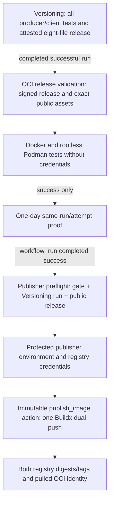

# Verified OCI publisher handoff

Status: Task [#165](https://github.com/wesley-dean/certbotbot/issues/165)
implementation, governed by [ADR-038](adr/ADR-038-verified-oci-producer-images.md),
[ADR-039](adr/ADR-039-alpine-oci-runtime.md), and
[ADR-040](adr/ADR-040-release-gated-dual-registry-oci-publication.md).
This is the workflow contract, **not evidence of a live image publication**.
Task #166 owns comprehensive registry-pull runtime, parity, SBOM and provenance
acceptance; task #167 owns the complete operator guide.

## Release event and proof chain

The source SHA, run ID/attempt, stable semantic version, producer SHA-256
and release handoff manifest SHA-256 are independently checked against
GitHub's original successful Versioning run and all eight public assets.
The proof artifact is treated as untrusted **data**; it is not a release
signature and cannot substitute for the GitHub API, tag, signature,
attestation and checksum checks.

The publisher is triggered by a completed **OCI release validation**
workflow, not a PR, manual branch dispatch, push, or an assumed
`GITHUB_TOKEN` tag-generated event. The original gate remains
unprivileged and never receives registry credentials. No publication job
can run before it passes.

## Required operator configuration

- The enabled publishing workflow on the default branch automatically
  attempts publication for every successfully validated current stable
  release. There is no separate repository variable or opt-in switch.
  Disable or remove the workflow if automatic publication is not intended.
- Establish GitHub environment `oci-registry-publish` with appropriate
  required reviewers, main-branch restrictions, and deployment controls.
  Do not rely on an automatically created unprotected environment.
- Supply protected `ghcr_username`, `ghcr_token`,
  `dockerhub_username`, `dockerhub_token` secrets. The GitHub job
  requests `packages:write` only on the protected publisher, and has
  no release-write or artifact-write permission.
- Independently confirm GHCR target
  `ghcr.io/wesley-dean/certbotbot` and Docker Hub target
  `docker.io/wesleydean/certbotbot`; these are **not inferred** from
  `GITHUB_ACTOR` or other repository names.
- Confirm the upstream pinned
  `wesley-dean/publish_image@94d42d58eab435d50991f561f27382c4dc3cedb4`
  is still the approved revision. Any upgrade must be reviewed as a new
  security-sensitive dependency change.

The complete checked, allowlisted publisher context contains the Alpine
3.24.3 digest-pinned Dockerfile, restricted package repositories, and
the **verified ordinary producer** (never the standalone client).
Initial builds select **linux/amd64 only**. Build arguments bind
`SOURCE_COMMIT`, `RELEASE_VERSION`, `PRODUCER_SHA256`,
`HANDOFF_MANIFEST_SHA256` and `BUILD_KIND=release`; they contain no
credentials. No host certificate archive, ACME private key, GPG secret,
AWS role credential, repository checkout or `.env` belongs in the
build context or image.

## Expected tag and registry behavior

For a verified stable `v0.3.1` release at source SHA
`0123456789abcdef0123456789abcdef01234567`, **each** registry
must receive the same one-build image digest under tags
`latest`, `0.3.1`, `0.3`, `0`,
`sha-0123456` and `sha-0123456789abcdef0123456789abcdef01234567`.
The exact supplied release ref and source SHA override the
`workflow_run` default-branch ref, so no `edge` tag is authorized
for this release-only workflow. The verification job rejects a
superseded release that is no longer GitHub's latest stable release.

After Buildx completes, both registry references, immutable digest,
the release/latest/full-SHA tags and the pulled images' architecture,
source revision and embedded producer digest must match the handoff
identity. A failure or ambiguous answer from **either registry**
fails publication. An earlier accepted push may remain remotely
visible after the other registry fails. There is **no distributed
rollback**; the maintainer must inspect and reconcile actual registry
objects independently before retrying.

The pulled images' complete package inventory, SBOM/attestation,
runtime lifecycle and cross-registry parity require additional
acceptance under #166. OCI image publication does not change the
operator's S3/Route53/ACME privileges or certificate installation
contract.

## What has and has not been verified

The version/ref parsing, fake-GitHub API event/proof tests, rejection
of mismatched run attempts, release status and identity, no-pr/no-tag
trigger restrictions and immutable action pin are covered by
[OCI publisher tests](../tests/oci-image-publication.bats).
The OCI release gate's own Docker/Podman smoke tests remain required,
and upstream `publish_image` issue #99 passed its isolated no-push
release/nonrelease checks. None of those tests constitute a live
credentialed dual-registry push.

A real completed gate triggered by a **newly verified stable release**
is required for end-to-end publisher acceptance. If unavailable,
task #165 remains open after code merge until the maintainer can
review real GHCR/Docker Hub evidence. Do not bypass the gate, forge
a GitHub event, select a development image as `latest`, or expose
publisher credentials to a PR test simply to obtain a green run.
