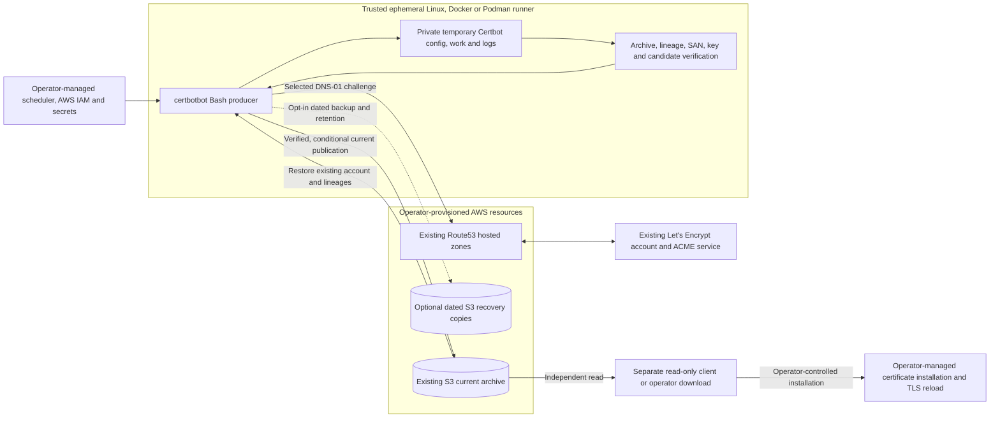

# Operator Quick Start: Registration and Certificate Issuance

This guide explains how certbotbot's one-shot producer fits into the
certificate lifecycle, how to explicitly register an existing-account seed,
and how to verify a standalone release before first use. Commands that
refer to `./certbotbot.bash` assume a trusted working directory containing
that executable. Do not substitute production credentials or resources
for the illustrative values without an independent operator review.

## How the pieces fit



An archive is the **contents of the Certbot configuration root**
(`/etc/letsencrypt`) using validated relative members and canonical
renewal metadata. The exact configured **current S3 bucket/key**
(default `latest.tar.gz`) is authoritative. A successful certificate
run does not imply downstream deployment. A failed or interrupted
S3 PutObject may have changed the remote object even if the
producer returns nonzero: the operation is **not** a transaction.

For administrators beginning with a delegated Route53 zone but **no bucket,
IAM role, seeded account or certificate**, follow the
[complete first-certificate walkthrough](administrator-first-certificate.md)
and its separately reviewed [AWS bucket/IAM runbook](examples/aws-bucket-bootstrap.md)
before ordinary issuance. Those instructions are operator-run examples,
not active GitHub Actions or cloud provisioning.

## Explicit account registration

The account-provisioning command is separate from certificate issuance.
It requires a contact email, an existing S3 bucket, and affirmative consent
to the Let's Encrypt subscriber terms.  EFF email signup defaults to
`true` and may be disabled explicitly.  Production is the default CA;
select `--acme-environment staging` when testing, with a **different S3
key** to keep account contexts separate.  For example, after reviewing
the terms and configuring AWS credentials:

```bash
./certbotbot.bash register \
  --email operator@example.org \
  --agree-tos true \
  --eff-email-signup false \
  --s3-bucket my-existing-certificates \
  --s3-key latest.tar.gz
```

The address and bucket are illustrative.  The command uses isolated
Certbot state, a verified account-only tar archive and conditional S3
publication.  No certificate is issued.  A confirmed missing S3 key is
permitted only for explicit registration; access errors and ambiguous state
are fatal.  The ordinary issuer accepts a *separate*, explicitly selected staging
CA and archive under ADR-042. Registration never implicitly starts issuance;
any milestone 4 live test must explicitly use staging and must never reach
Let's Encrypt production.
See [the registration contract](acme-account-registration-contract.md)
and [ADR-041](adr/ADR-041-explicit-acme-account-registration-and-state-initialization.md).

## Quick start: existing account and seeded archive

This is a **production-adjacent example, not an unattended setup
script or evidence of a live service test**. Prepare the prerequisites
before executing any credentialed command:

1. **Account and archive:** Before ordinary issuance, seed an existing
   bucket/key with a valid full Certbot-state `tar.gz` containing an
   account matching the selected Let's Encrypt CA (production by
   default, or explicit staging). Use the supported **separate**
   `certbotbot register` command to initialize a *positively missing*
   current key with native account-only state after reviewing the
   terms and configuring the bucket/IAM identity, or verify an
   independently prepared compatible account archive. An account-only
   archive is allowed for initial issuance; a missing archive or
   missing account is **not** accepted by ordinary issuance.
2. **DNS and AWS identity:** Provision a Route53 hosted zone for
   the requested DNS-01 challenges and a trusted AWS CLI identity
   with narrowly scoped S3 reads/writes and necessary Route53
   TXT-change and status-check permissions. Configure AWS region,
   network access and credential delivery separately. If dated
   backups or retention are enabled, review their additional
   conditional-write/list/delete permissions first.
3. **Trusted Linux toolchain:** Install Bash **4.3+**, AWS CLI
   **v2**, Certbot with the `dns-route53` plugin,
   OpenSSL, GNU tar/gzip and standard file/hash utilities.
   GnuPG **2.4.7+ with working AES-256/OCB support** is
   additionally required for encrypted archives. The runner
   must keep its temporary Certbot workspace private.
4. **Reviewed release artifact:** Choose an immutable reviewed
   release tag, verify the [release checks and provenance](release-verification.md),
   and obtain an **independently verified** SHA-256 for the
   ordinary `certbotbot.bash` executable. Never treat the
   downloaded executable and its same-origin checksum alone as
   sufficient proof of release trust.
5. **Only one writer per current key:** Schedule and coordinate
   certificate jobs so that two producers cannot concurrently
   modify the same authoritative bucket/key, even across
   Jenkins, GitHub Actions, containers and other hosts.

With the GitHub CLI, a trusted `sha256sum` implementation and
the expected digest obtained **out-of-band from your review**,
the following shell example fails closed until its placeholders
are replaced:

```bash
set -euo pipefail
umask 077

RELEASE_TAG='vREPLACE_WITH_REVIEWED_TAG'
EXPECTED_SHA256='REPLACE_WITH_INDEPENDENTLY_REVIEWED_64_HEX_DIGEST'

[[ "$RELEASE_TAG" =~ ^v[0-9]+\.[0-9]+\.[0-9]+$ ]]
[[ "$EXPECTED_SHA256" =~ ^[0-9a-f]{64}$ ]]

mkdir -m 0700 ./certbotbot-release
cd ./certbotbot-release
gh release download "$RELEASE_TAG" \
  --repo wesley-dean/certbotbot \
  --pattern certbotbot.bash \
  --pattern certbotbot.bash.sha256

sha256sum --check certbotbot.bash.sha256
actual="$(sha256sum certbotbot.bash | awk '{print $1}')"
[[ "$actual" == "$EXPECTED_SHA256" ]]
gh attestation verify certbotbot.bash \
  --repo wesley-dean/certbotbot >/dev/null
gh attestation verify certbotbot.bash.sha256 \
  --repo wesley-dean/certbotbot >/dev/null

bash -n certbotbot.bash
chmod 0700 certbotbot.bash
./certbotbot.bash --help
./certbotbot.bash --version
```

For the **standalone Bash tools**, rather than the container image,
the ordinary producer and separate read-only client are available from
[GitHub Releases](https://github.com/wesley-dean/certbotbot/releases).
You can also use [`vet`](https://github.com/vet-run/vet) to download,
inspect, lint (when ShellCheck is available), and explicitly approve
a remote release script **before executing it**, for example:

~~~bash
vet https://github.com/wesley-dean/certbotbot/releases/latest/download/certbotbot.bash --help
vet https://github.com/wesley-dean/certbotbot/releases/latest/download/certbotbot-client.bash --help
~~~

`vet` runs the fetched script for this invocation; it does not install
a permanent copy or replace independent release and attestation checks.
Use the release assets above when you need locally installed executables.

The download commands intentionally do **not** contact S3, Route53
or ACME. Once the real account, archive, permissions and selected
domain have been **independently prepared**, an ordinary invocation
from that private directory looks like:

```bash
./certbotbot.bash \
  --s3-bucket my-existing-certificates \
  --s3-key latest.tar.gz \
  example.com
```

Here `my-existing-certificates` and `example.com` are **illustrative
values**, not provisioned resources. The default
`INCLUDE_SUBDOMAINS=true` also requests the complementary wildcard
SAN, so `example.com` normally requests both `example.com`
and `*.example.com`. Use `--include-subdomains false`
when only the literal name is desired. For a stable lineage
across SAN changes, use an explicit `--cert-name`.

A successful run prints a nonsecret selected-lineage and
`s3://bucket/key` status containing `published=true`
or `published=false`. An unchanged, validated no-op is still
success and normally skips the remote write. A failed provider,
unsafe archive, mismatched certificate/key or incomplete candidate
must not authorize publication; after an attempted remote write,
the remote state can be **uncertain**. Inspect the current object
independently rather than blindly retrying a failed or partial
publication. See [failure and recovery details](how-it-works.md).

## Further reading

- [Complete producer lifecycle](how-it-works.md), including failure and recovery behavior
- [First-certificate setup from zero](administrator-first-certificate.md), including AWS resource preparation
- [Registration contract](acme-account-registration-contract.md) and [selected-CA rules](adr/ADR-042-explicit-ca-bound-staging-issuance.md)
- [Configuration and command-line reference](configuration-reference.md)
- [Signed-release and artifact verification](release-verification.md)
