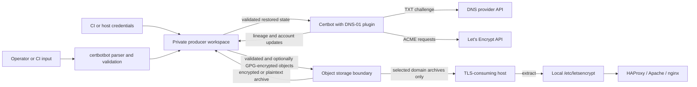

# certbotbot Threat Model

Status: Initial design threat model, 2026-10-15.  Mitigations below are design requirements, not claims that unfinished implementation has passed testing.

This model applies the inherited `doc/threat-modeling.md` guidance and the imported standards security requirements.  Changes to storage, issuance, encryption, CI authority, archive format, dependency trust, or runtime providers require review.

## Security objectives and assets

Protect the confidentiality and integrity of TLS private keys, historical lineage keys, ACME account credentials, GPG passphrases, AWS/API credentials, certificate metadata, archives, and release artifacts.  Preserve the correctness of DNS challenges and the ability to recover from failures without accidentally overwriting the last known good certificate state.

## Trusted computing base

The trust boundary includes the Bash runtime, generated certbotbot artifact, bundled bashlog/mktext code, Certbot and its DNS plugin, AWS CLI, GPG, tar, local system libraries, CI execution host, cloud identity/permissions, object store, signed/reviewed build inputs, and the release toolchain.  The Bash runtime provides neither strong process isolation nor secure memory erasure.

## Trust and data flows

The consumer boundary excludes ACME account state by default and never requires Certbot or the producer program.  Consumer-side reloads and post-install scripts remain outside certbotbot's authority.

## STRIDE-oriented risks and mitigations

| Category | Threat or failure | Required mitigation and evidence |
| --- | --- | --- |
| Spoofing | Unauthorized actors use DNS/S3 credentials or impersonate the publisher | Least-privilege identity, CI secret isolation, audit records; GPG symmetric encryption alone does not authenticate publication |
| Tampering | Poisoned archive paths, symlink escapes, hostile tar metadata, replayed older objects | Validate archive member paths/types/targets before extraction; verify expected per-lineage scope; consider version pinning and signature support later |
| Repudiation | No reliable record of which actor published state | Log object identity, build/version, time, selected lineage and outcome without secrets; document audit trail limitations |
| Information disclosure | Private keys or passphrases leak to logs, temporary files, snapshots, old S3 versions, or consumers | Private workspace, `umask 077`, restrictive file modes, no command-line passphrases, CI masking, encryption when configured, avoid consumer distribution of common account archive |
| Denial of service | Invalid SANs, DNS validation failures, Let's Encrypt rate limits, storage outages, failed uploads, simultaneous writers | Preflight validation, finite retries/backoff where justified, serial processing, clear missing-vs-failed reads, fail closed, storage lock backlog |
| Elevation of privilege | Runtime plugin loading, untrusted shell evaluation, tar extraction, unsafe CI execution of PR code with credentials | In-tree provider bundling only, shell arrays, reject unsafe tar members, least privilege, separate release/secret contexts |

## Additional trust boundaries

### Input parsing and command construction

Do not interpolate operator input into shell source or run `eval`.  Reject hostnames beginning with option prefixes or containing path separators.  Wildcard patterns must remain literal until validated and passed to Certbot through arrays.  Test that malicious characters do not result in process execution.

### Storage state and concurrent writers

No distributed lock exists in the initial release.  Independent runners sharing a bucket/namespace can lose updates.  CI-only or host-only serialization is not a global guarantee.  A storage-backed lease with fencing, contention tests, and stale lease handling is required before advertising multi-writer support.

### Archive content and symlink integrity

Certbot's normal `live/` links are relative references to `archive/`.  Malicious or malformed tar members can replace files outside the intended workspace or create links crossing lineages.  Validate the full extraction plan, not solely file extensions.  Prefer staged extraction with secure ownership and verify link targets and certificate/private-key matching before publication.

### GPG confidentiality and migration

An unset passphrase means explicit plaintext object storage; documentation must disclose this.  Nonempty passphrase means encryption is required uniformly and decrypt failures are fatal.  Encryption does not sign content.  Manual migration must address S3 object version retention and plaintext remnants.  Neither filesystem deletion nor removal of an S3 current version alone guarantees destruction of historical plaintext.

### AWS endpoint and credentials

A custom S3 endpoint can redirect credentials and certificates to a different service; endpoints must be explicit and operator trusted.  Least-privilege Route53/S3 policies must restrict hosted zones, buckets, and prefixes.  Support assumed-role/OIDC temporary credentials and `AWS_SESSION_TOKEN`.  Do not demand static access keys when the SDK credential chain already works.

### Build/release supply chain

Only the pinned released bashdeps bootstrap is directly downloaded by Make.  Bashdeps handles declared artifacts and validates committed digests.  The coding standards snapshot is a separate reviewed governance artifact.  Generated release files must retain provenance and pass all-flavor tests and checksum verification.  Untrusted PRs must not receive issuance/release credentials.

## Initial implementation evidence and remaining integration gap

Build-time included providers expose validated S3 get/put argv construction,
a read-only Certbot probe, and a host-local advisory lock.  PATH-injected
fake-executable tests exercise argument preservation, fail-closed invalid
object/endpoint behavior, and local lock contention.  At this stage no
production-run orchestration calls them.  In particular, the S3 adapter
does **not** yet implement missing-versus-failed classification, safe
archive restoration, atomic local downloads, or publication rollback.
The local lock is not a distributed lease.  Future certificate orchestration
must be reviewed for explicit lock lifecycle, private workspace handling,
and fail-closed object classification before cloud credentials are usable.

## Explicit non-goals and residual risk

The first release does not promise atomic multi-object publication, cross-platform locking, cryptographic publisher authentication, safe execution on a compromised producer host, secure erasure of memory/swap, or automatic consumer deployment rollback.  Storage provider outages and LetsEncrypt service/rate-limit changes can prevent renewal.  The consuming server's root filesystem, service credentials, and post-install behavior are its own responsibility.

## Verification strategy and review triggers

Bats should include negative assertions (no upload on invalid input/failed renewal; no plaintext fallback; no secret logs; no unsafe path extraction) plus functional tests for symlinks, combined PEMs, and independent archive composition.  Integration tests should use isolated storage and Let's Encrypt staging with non-production DNS resources.  Revisit this model when adding DNS providers, storage providers, alternate encryption, GPG rotation, distributed locking, signed archives, CI permissions, or new runtime dependencies.

## Route53 issuance adapter safeguards

The isolated Route53 adapter uses a fixed `certonly` DNS-01 argument vector,
requires owned private Certbot directories, and passes each SAN as a separate
quoted argument.  Mock tests exercise malformed/missing SAN rejection,
unexpected directory permissions, and Certbot failure propagation.  The
public executable still has no issuance path.  A successful mock invocation
does not establish portability of imported Certbot renewal metadata, validate
potential hooks in restored state, or demonstrate real ACME issuance.  ADR-025
requires restore-to-new-workspace integration tests before activation.
